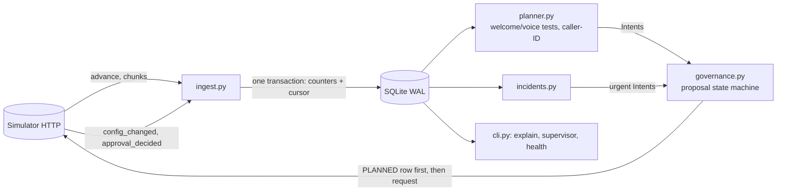

# Outcome-First Agent Loop — Submission

**Name:** [fill in] · **Date:** 2026-11-07 · **Hours actually spent (be honest):** [fill in] · **Language / storage:** Python 3.10 (numpy, httpx) / SQLite (WAL), no new dependencies

> Copy this file to `SUBMISSION.md`. Keep the headings. Be concrete: numbers, examples, diagrams. If a
> section doesn't apply, say why in a line rather than deleting it.

---

## 0. TL;DR
A single-process controller. It stores per-arm counters from the event stream in SQLite, runs randomised welcome/voice tests with one deterministic decision rule, reroutes degraded caller IDs, answers hallucination incidents (previous prompt first, LLM only if needed), and sends every change through an explicit proposal state machine with deterministic ids.
public_01 +8.0% conclusion rate vs baseline (8 changes, 0 harmful); public_02 +21.2% (15 changes, 0 harmful, hallucinated calls 416→179, 5 credits); public_03 +16.7% in 4 min 09 s (39 changes, 1 harmful).
Four SIGKILLs mid-run, with approvals pending: no duplicate, no lost proposal, one continuous audit trail.
Not built: call-time optimisation, cross-axis cohorts, UI, cross-tenant credit arbitration.
Weakest points: little statistical power at dev scale (9–28% of the engagement headroom) and slow decay detection on small workflows.

## 1. Assumptions
1. **Welcome message and voice act after pickup**, so they can move engagement but not pickup; only caller ID and *who is dialled when* can move pickup. Pickup-primary workflows therefore get caller-ID work, not welcome/voice tests (I did not build call-time work, §2). Guardrail checks still measure the other KPI for every candidate.
2. **Guardrail `*_max_drop` is an absolute drop in the guardrail rate** (0.02 = two points), checked as P(drop within tolerance) ≥ 0.80.
3. **History carries no variant information**: the default config allocates one welcome message and one voice, so pre-D0 data gives baselines, hour profiles, caller-ID baselines and the hallucination base rate, never option priors.
4. A global hour-weight table is a no-op (it scales every eligible lead equally); only a table that differs between groups changes who is dialled when. I did not build call-time optimisation (§2).
5. Each dial's welcome/voice/caller-ID is sampled independently (per the contract), so marginal arm contrasts are unbiased even when the other dimensions vary. Contrasts are stratified by (config version × cohort) so allocation changes cannot confound them.
6. QA hallucination flags are noisy: baseline is estimated from the workflow's own pre-incident flag rate (false positives included), never assumed to be zero.
7. Validation measures safety only. Engagement after a prompt change is verified from production calls; a fix that hurts engagement is treated as a regression.
8. The approver is a black box with working hours and latency; decision time ≈ next_working(now + latency). Requests that cannot be decided inside their TTL are not sent (they would be guaranteed to expire).
9. Fatigue limit (`max_requests_per_24h`) counts every request, including rejected and expired ones; the controller keeps one slot per 24h in reserve for incidents.
10. A supervisor edit is legitimate and wins: the edited dimensions are put on a 48h hold, experiments are re-derived from the live config, in-flight proposals are left to go stale and are re-planned. The one exception is an incident fix, which is *proposed* (never forced) and explains the evidence.
11. Hidden scenarios share the public schema/ranges (≤20 cohorts, 15-minute ticks, same event types and start date). The date of D0 is read from `/sim/state`, never hard-coded.
12. Call-time optimisation (per cohort or per person) was not built. A person has 1–3 connected calls in the horizon, and cohort-level tables only help if hour preference correlates with the lead features, which I could not check from the API.

## 2. Scope decisions
| # | Capability | Status | Why | What finishing it would take |
|---|---|---|---|---|
| C1 | Event ingestion | Built | Everything depends on it. Streamed NDJSON, one transaction per chunk covering counters and cursor, replay is a no-op. | Per-workflow sharding for 10×. |
| C2 | Shared cohort object | Partial | One `cohorts` table and one id scheme (`age_band=60+`) used by experiments, config, audit and the supervisor view. One partition axis per workflow, single-value cohorts only. | Cross-axis cohorts. |
| C3 | History bootstrap | Partial | History gives the KPI baselines, caller-ID baselines and the hallucination base rate. It has no variant information (the default config has one welcome and one voice), so there are no option priors. | Nothing to add until history contains variation. |
| C4 | Call-time optimisation | Not implemented | Removed in review. A global table is a no-op, a per-cohort table depends on hour preference correlating with lead features (unverifiable here), and its measured effect in the public runs was within noise. | Per-person preferred hour, evaluated against a hold-out. |
| C5 | Caller-ID health | Built | Pickup compared between concurrent, randomly assigned caller IDs; flagged ID kept at a floor; untested IDs probed. | Load-aware allocation. |
| C6 | Welcome/voice experiments | Built | Randomised arms, one decision rule (§5). | Interaction model. |
| C7 | Promotion, decay, rollback | Built | 85/15 promotion; rollback when the winner stops clearing the bar against its holdout. Detection is power-limited on small workflows (§13). | A sequential change detector. |
| C8 | Hallucination incidents | Built | Detect, previous prompt first, LLM only if needed, validate, propose with evidence, verify flags and engagement. | — |
| C9 | Governance client | Built | Explicit state machine, deterministic ids, TTL/hours/fatigue-aware submission, stale/abandoned handling. | — |
| C10 | Honest scores/dry runs | Partial | Formulas and fields are real, but the dry run replays the same data that produced the decision. | Replay on a held-out window. |
| C11 | Supervisor view | Partial | CLI (`supervisor`), no web UI. | A JSON endpoint over the same query. |
| C12 | Audit store | Built | Decisions, evidence, route, approval transitions, apply and follow-up are rows; `explain` reconstructs them. | Retention policy. |
| C13 | Crash recovery | Built | Demonstrated with SIGKILL (§9). | — |
| C14 | Observability | Partial | `metrics` table, `health` command, explicit page/no-page list (§10). No exporter. | Prometheus endpoint. |
| C15 | Fair credit/attention allocation | Not implemented | Only incidents spend credits (capped per incident), and the per-workflow request slots protect approvers. There is no cross-tenant arbitration. | A weighted queue across tenants. |

I built the loop end to end and spent the effort on the parts that can hurt a client: governance, the decision rule, incident handling, crash safety, audit. I cut the levers whose evidence I could not defend.

## 3. Stakeholders
### 01 Sales — Nikhil Rao
- **Accepted:** speed where it is safe: rollbacks, harm stops and caller-ID rotations use the fast path; routine batching is minimal; the supervisor view gives a per-client lift table.
- **Declined:** a single blended score (violates the KPI definition and Product's memo); promoting a winner to everyone by evening (we promote 85/15 with a holdout and need evidence first); the "persuasive" prompt (it is the one that raises hallucination risk; prompts only change through an incident fix with validation).
- **Wrong against the contract:** "Kestrel has auto-apply for everything" — `ks_cancel` allows only schedule, caller_id, welcome_message, voice, capped at a 0.2 shift; prompts and cohorts are not allowed. "Northwind is fine with auto-apply on KYC" — `nw_kyc` has auto-apply **disabled**.
- **Reply:** *Nikhil — you'll get a lift figure per client per KPI (pickup, engagement, conclusion), not a blend; blending hides which lever moved. Winners go live at 85% with a 15% holdout so we can prove the lift and catch decay; I won't take it to 100% by evening. Kestrel's policy only auto-applies schedule, caller-ID, welcome and voice within a 0.2 shift, and Northwind KYC has auto-apply off, so those changes go through the approver. The "persuasive" prompt is out unless an incident fix validates it. For the summit I can show the audit trail of one real change end to end.*

### 02 Compliance — Meera Iyer (Northwind)
- **Accepted:** all customer-facing changes (welcome, voice, prompt, cohorts) go through a named approval on Northwind workflows (their policy permits auto only for schedule/caller_id, and we don't auto-apply customer-facing growth moves anywhere); prompt changes carry a validation run; every proposal has diff/dry-run/rationale; `explain` reconstructs variant-and-reason by config version.
- **Declined:** "no customer even briefly worse off" cannot be guaranteed by any experiment; we bound it (harm stops, minimum evidence, control share ≥ 40%) and say so. A per-customer "what did they hear" answer needs the call events (`variant`, `config_version`) held by the platform; our store gives the version-level reason and the lookup key.
- **Wrong/clarify:** approvers work 10–19 (KYC 10–18); a request sent at night is *guaranteed* to expire on a 12h TTL, so we hold such requests until the window opens.
- **Reply:** *Meera — agreed on all five. Anything a customer hears (opening line, voice, script) is proposed to your named approver with the diff, dry run and, for scripts, a validation run; operational changes (timing, caller-ID rotation) are applied within policy and listed in the weekly summary. For an auditor's question we can show, per config version, the variant and the reason it was live; the per-call lookup uses the platform's call event, which carries that version. Experiments are bounded (the incumbent keeps ≥40%, harmful arms are stopped on evidence) but I can't promise zero exposure to a worse variant.*

### 03 Platform/SRE — Kabir Menon
- **Accepted:** kill/restart test (§9), idempotent writes with deterministic proposal ids, no new infrastructure (embedded SQLite file, one process), `health` command, explicit pageable-alert list (§10), 10× analysis (§8).
- **Declined:** reusing Postgres/Redis for now — a single-writer embedded store is enough at this scale and has no 2 a.m. operator; sharding by workflow is the migration path.
- **Wrong/clarify:** none factually wrong; the 10 min/day target is measured in §8.
- **Reply:** *Kabir — killed with SIGKILL four times mid-run (including with approvals pending); it resumed from a durable cursor, never double-applied and kept one continuous audit trail (reports/crash_recovery.md). State is one SQLite file (WAL) written transactionally; no Redis/Postgres needed at this scale, and the 10× plan is to shard workflows across processes with a DB each. `controller.cli health` shows ingest lag, decisions, credits and what is page-worthy; only stuck proposals, escalated incidents, ingest failure and credit exhaustion should page.*

### 04 Client ops supervisor — Anita Desai (Kestrel)
- **Accepted:** her edits are never undone (48h hold on edited dimensions; in-flight proposals go stale and are re-planned); one batched request per workflow, routine requests never before 11:00 and at most 2 a day; one-screen supervisor view; fixes are checked for engagement after rollout (the verbatim-script failure mode).
- **Declined:** "tell me *before* anything changes": changes that go through an approval are announced by the request itself; auto-applied changes are limited to protective moves (rollbacks, caller-ID health, incident fixes where permitted) and appear in the view and digest. We cannot block those without losing the fast path.
- **Wrong/clarify:** Kestrel's policy allows up to 4 requests/24h; her "2 a day, not before 11:00" is stricter and is adopted as our self-imposed routine limit, with incident fixes exempt.
- **Reply:** *Anita — your edits stay: if you change something we hold off that dimension for 48 hours and re-plan around it. You'll get one batched request at a time, never before 11:00, at most two routine requests a day; fixes for a bad prompt are the exception. `controller.cli supervisor` is the one screen: what's being tested, what's winning, what's waiting on you, what changed today. Prompt fixes are re-checked on engagement after rollout, so a safe-but-lifeless script gets flagged. One thing I can't promise: protective changes (rolling back a decayed winner, rotating a bad caller ID) may apply without a prior request.*

### 05 Product — Tara Kulkarni
- **Accepted:** pickup/engagement/conclusion never blended; one cohort object (`cohorts` table, same id in config, experiments, audit and view); minimum sizes with the cost stated (§5); proposals carry impact/diff/affected/dry-run with a documented formula; only observed exposure counts (evidence = recorded calls by variant and version); a winner changes that workflow only.
- **Declined:** per-person call-time as P0 (not built, assumption 12); treating an expired proposal as a bare rejection — we do treat it as a non-decision, wait for a cooldown and re-propose with *fresh* data and a new id, never the stale body.
- **Wrong/clarify:** "ranking the queue by impact" works only if the score is comparable across workflows; ours is bounded and based on expected lift × population × confidence.
- **Reply:** *Tara — held to all your definitions: pickup, engagement and conclusion are separate everywhere; one cohort object with one id across detection, experiments and the supervisor view; only calls that actually ran count as evidence. A cohort needs ≥8% of traffic and ≥200 trials per arm-slice, which costs days of speed to avoid false winners. Impact score = 1−exp(−(expected relative lift × share affected × confidence)/0.03), bounded in [0,1], so it ranks. Call-time optimisation (per person or per cohort) and a web UI are not built; caller-ID health and the supervisor CLI are in.*

### 06 CTO — Aryamann
- **Accepted:** choose and say no; spend credits only where they change a decision (5 credits in public_02: one validation, no LLM call because the last-good prompt validated); trust the contract over memos; documentation for the on-call.
- **Declined:** nothing to decline; this memo is a rubric.
- **Reply:** *Aryamann — understood. Not built: call-time optimisation, cross-axis cohorts, UI, cross-tenant arbitration. Built end to end: ingest, experiments with rollback, caller-ID health, incident loop, governance, audit, crash recovery. Public_02 spent 5 credits: the last-good prompt was free to propose and needed one validation. What breaks first at 10× is the single-process aggregation of one workflow's chunks; the plan is per-workflow sharding.*

## 4. Architecture

| module | why it exists |
|---|---|
| `ingest.py` | Turns events into additive counters. numpy is used for the group-by (7% of ingest time; the pure-Python equivalent was ~4× slower for that step: 0.89 s vs 0.24 s per 200k events). |
| `store.py` | Schema with `CHECK` constraints on proposal and incident states; `tx()`; `audit()`. The only durable state. |
| `evidence.py`, `stats.py` | Read-side queries and a handful of closed-form functions. No randomness. |
| `planner.py` | Welcome/voice tests and caller-ID health. Pure functions of (counters, live config, small experiment memory). |
| `incidents.py` | Detection and the fix workflow; the only place credits are spent. |
| `governance.py` | The only code that talks to `/approvals`, `/apply` and `PUT /config`. |
| `main.py` | The loop and supervisor-edit detection. |

State: SQLite only. Counters keyed by (workflow, 6-hour block, config version, cohort, lever, option, one-feature slice); experiment memory; cohort registry; proposals; incidents; credit ledger; audit; metrics. The remote config is authoritative: it is re-fetched every step, and the local `config_versions` table is only a record of what was observed.
On restart: reopen the DB, read `/sim/state`, ingest from the cursor, refresh configs, then `reconcile` proposals (§6). If the DB belongs to a different simulator world (different scenario, first-chunk fingerprint or workflow set) it is moved aside, never reused.

## 5. The learning loop
**The method, in plain terms.** For each lever (welcome message, voice) the controller keeps successes/trials per arm, per config version and cohort. An arm is compared with the control: the difference of two Beta posteriors (prior = the workflow's own historical rate, weight 4), normal approximation. Three outcomes:
- *Win*: ≥250 KPI trials in both arms, P(lift > 3% relative) ≥ 1 − 0.05/(number of challengers), and the guardrail KPI is not credibly breached. Several winners are ranked by lower credible bound, not point estimate.
- *Harm*: P(arm worse than control by 2% relative) ≥ 0.95. The arm is removed and never offered again for that lever.
- Otherwise: keep collecting.
A win moves that arm to 85% with the control as a 15% holdout. Later the winner is compared with its holdout over a 36-hour window; if P(its lift still clears 3%) ≤ 0.2, or it is credibly harmful, it is rolled back to the control and the lever is re-explored without harmful arms. Contrasts are computed per (config version × cohort) stratum and combined by inverse variance, so a change in allocation mid-test cannot bias the comparison.

**What each mechanism prevents** (and what I removed in review):
| mechanism | failure it prevents | status |
|---|---|---|
| minimum 250 trials | deciding on a handful of calls; invalid normal approximation | kept |
| practical-lift threshold (3%) | spending an approver's attention on a lift that cannot matter | kept |
| Bonferroni over challengers at α=0.05 | picking the luckiest of several arms | kept (replaced Šidák) |
| stratification by version × cohort | Simpson-type bias when allocation changes | kept |
| harm stop | continuing to serve a credibly worse arm | kept |
| guardrail check | winning on the primary KPI while hurting the other | kept |
| holdout + practical-bar demotion | a winner that stops winning staying live | kept (replaced a rule that used the biased promotion estimate) |
| empirical-Bayes shrinkage, Cochran Q gate, Šidák | multiplicity of slice tests | **removed**: three techniques for one problem; replaced by Bonferroni over every (slice, option) examined |
| futility pruning | wasted traffic on hopeless arms | **removed**: its error rate under repeated looks was never measured |
| hour-weight (call-time) planner | — | **removed** (§2, C4) |

**Cohorts.** One partition axis per workflow (one lead feature, chosen when the first cohort is justified), single-value cohorts on it (`age_band=60+`), so cohorts never overlap. A cohort is created only if some option beats the workflow-wide action inside that slice under the same rule above, with Bonferroni over all (slice, option) pairs examined, the slice has ≥8% of traffic and ≥200 trials per arm, and the gain is ≥0.4 points. Options already shown harmful are excluded. At most 6 cohorts. Otherwise the controller stays at workflow level. The cost: the single axis cannot exploit "voice by age" and "welcome by language" together.

**Welcome × voice.** Both are explored in the same stream of calls. The simulator samples each independently, so each marginal comparison is unbiased; I did not model the interaction. The incumbent keeps ≥40% (≥70% if a supervisor chose it) and is the control.

**Caller ID.** Every dial's caller ID is random, so concurrent IDs are directly comparable. An ID is flagged if its pickup over 36 hours is significantly below its siblings' pooled rate (one-sided z, Bonferroni over IDs, ≥15% relative drop, ≥200 dials). A flagged ID is kept at a 3% floor, with the flagged set persisted so it is not mistaken for "untested"; untested IDs get 8% until measured. Recovery needs ≥300 dials at the floor back within 10% of siblings.

**Operating characteristics of the decision rule** (`scripts/false_winner_sim.py`, 8 sequential looks of 150 connected calls per arm):

| scenario | P(promote some arm) | mean connected calls per arm at promotion |
|---|---|---|
| all arms identical, 1 challenger | 5.0% | 430 |
| all arms identical, 3 challengers | 3.5% | 542 |
| one challenger +6% relative | 37.5% | 644 |
| one challenger +10% relative | 77.0% | 588 |
| one challenger +10% of 3 | 56.0% | 688 |

With α=0.05 the false-promotion rate over eight looks stays at about 5% or below; the price is power: three challengers with a real +10% lift are found 56% of the time inside the eight looks.

**Policy values.** A = contract, B = business policy, C = derived, D = heuristic. Every value is in `controller/policy.py` with its class.
| value | class | reason |
|---|---|---|
| α = 0.05, harm 0.95 | C | conventional; harm uses the same level |
| 3% relative practical lift | B | smaller changes are not worth an approver request |
| 2% relative harm | B | |
| 250 trials per arm (200 per slice) | D | validity of the normal approximation at p≈0.5; blocks decisions on tiny samples |
| 85/15 promotion | B | 15% holdout keeps decay measurable while capturing most of the lift |
| 40% incumbent share during tests (70% when a human chose it) | D | control must keep enough data; a human's choice is a prior in its favour |
| 36h decay window, ≥100 trials, P ≤ 0.2 | D | |
| cohorts: ≥8% share, ≥0.4pt gain, ≤6 | D | a cohort must pay for itself |
| 48h supervisor hold; routine requests ≥11:00, ≤2/day; 1 of the 24h request slots kept for incidents | B | supervisor memo; policy |
| caller-ID 15% drop, 3% floor, 8% probe, 12h between changes | B/D | |
| incident rule (§7) | C/B | |
| max requests per 24h, TTL, approver hours, apply window | A | from the workflow policy |

## 6. Governance
```
PLANNED --sent--------> PENDING --approved--> APPROVED --apply--> APPLIED
   |  \--auto route (PUT /config)---------------------------------> APPLIED
   |                      |  \--rejected--> REJECTED      APPROVED --410--> LAPSED
   |                      |  \--expired---> EXPIRED       APPROVED --409 stale--> STALE
   |                      \--base moved while waiting--> ABANDONED
   \--409 stale / 403 refused / unrecoverable--> STALE | REFUSED | FAILED
```
The table is `TRANSITIONS` in `governance.py`; every state change goes through one function that raises on an illegal move, and the database has a `CHECK` on the state column. Terminal states are re-planned from fresh evidence and the current base version, under a new id.

**Identity and ordering.** `pid = <workflow>-v<base>-<sha1 of proposed config>[-rN]`, written as `PLANNED` before any request. One routine proposal in flight per workflow; incident work may go alongside a routine proposal (if the routine one is applied first, the incident one goes stale and is re-planned).

**What happens if the process dies around each side effect:**
| side effect | dies before the request | dies after the server accepted it, before our commit |
|---|---|---|
| `POST /approvals` | `PLANNED` row exists, not in `/approvals` → resend same id | found in `/approvals` by proposal id → adopted |
| `PUT /config` (auto) | `PLANNED` → resend same id (a 403 does not consume the id) | found in config history by proposal id → `APPLIED` |
| `POST /apply` | state `APPROVED` → apply again | server answers 409 `not_approved`; approval says `applied` → look up version in history |
| `POST /sim/advance` | nothing happened | state re-read; never resent blindly |
| validation / LLM (credits) | nothing recorded → run once | result is lost and the credits are spent again on retry (the API has no way to fetch a past run) |

**Timing.** A request whose worst-case decision time (`next_working(now + max_latency)`) falls after its TTL is guaranteed to expire, so it is held until the approver window opens. Routine requests wait until 11:00 and are limited to two a day; one of the 24h slots is kept for incidents; while anything is pending the loop polls every 15 simulated minutes so the 2h apply window is not missed. A rejected or expired change is retried after 6 hours, up to 3 times, under a new id and with fresh data.

**Auto-apply.** Used only if the policy enables it, every changed dimension is allowed, the total-variation shift is within `max_shift`, and the change is operational (caller ID) or protective (rollback, harm stop, incident fix). Welcome, voice, cohorts and prompt growth moves always go to a human, even where the policy would allow auto-apply, because the Compliance and Kestrel memos ask to be told first.

**Supervisor edits.** The remote config is re-read every step. A `config_changed` by a supervisor is recorded; the edited dimensions are held for 48h; a running test whose allocation was rewritten is reset; a pending proposal whose base version is no longer current becomes `ABANDONED` (the approval stays in the simulator and would fail at apply anyway). New proposals are built from the current config, so unrelated edits are preserved. A prompt edit is not held (the incident loop must be able to react) but a fix is only ever proposed.

**Proposal fields.** `affected_leads` = live leads (inside the cadence window) in the changed scopes. `dry_run` = the recorded outcomes of the randomised arms replayed under the old and new allocation, with a 95% interval; per-ID pickup for caller IDs; the validation run for prompts. `impact_score` = `1 − exp(−(expected relative lift × share affected × confidence)/0.03)`, incident fixes ≥0.9. The dry run reuses the data that produced the decision, so it is a consistency check, not an out-of-sample estimate.

## 7. Incidents
- **Detection.** Flag rate of connected calls on the current prompt since the version that introduced it, against the workflow's own earlier flag rate b0 (false positives included). An incident opens when n ≥ 150, ≥5 flags, P(X ≥ k | p₀ = 1.25·b0 + 0.001) < 0.001, and the rate is ≥ 2·b0, on two looks at least 45 minutes apart. One flagged call cannot open one, and a rate at baseline cannot (both tested). Per look the false-open probability is at most 0.1% before the two extra conditions.
- **Fix.** (1) A prompt this workflow ran before, whose production flag rate was within baseline, is the first candidate and costs nothing to nominate; (2) each candidate gets one validation run (n=500, 5 credits) and must clear `min_validation_pass_rate`; (3) only if none passes: one LLM call (3 credits, at most 2 rounds), at most 3 suggestions validated, and the current prompt validated once as a reference — an untried prompt must beat it with z ≥ 1.64; (4) otherwise the incident is escalated. Validation says nothing about engagement, so after the fix lands I check the flag rate (resolved when ≤ max(half the incident rate, 1.5·b0 + 0.003) on ≥200 calls) and engagement against the earlier prompts (reopen if credibly more than 7% lower).
- **public_02, ks_cancel (from the audit store):**

| sim time | event |
|---|---|
| D2 10:00 | (simulator) a caller ID is flagged; the controller reroutes within a day: its share of dials 38.5% on D2 → 3.3% on D3 |
| D3 11:30 | supervisor ships prompt P2; recorded as `supervisor_edit` |
| D3 13:45 | incident opened: 16/227 = 7.0% flagged vs 1.4% baseline; candidate P1 (the previous prompt) validated at 0.986 on n=500 (5 credits, no LLM call); proposal sent |
| D3 15:36–16:00 | approver decides; applied, **MTTR 270 min** |
| D3 18:15 | verified: 2/234 = 0.9% flagged, incident closed |

Credits used: **5 of 200**. Worst case, the same incident arriving at night waits for the approver (§6 timing).

## 8. Scale
Measured on public_03_load (`reports/load_test.md`; reproduce with `scripts/run_scenario.sh 03_load`): the whole run — 7 history days + 5 live days, 12 workflows, 9.74 M events, simulator running on the same machine — took **4 min 09 s** (about 50 s per live simulated day against the 10-minute budget). Ingest: 62 k events/s during the history bootstrap, 64 k events/s live. Decision lag per step: mean 0.33 s, p95 0.94 s, max 6.6 s (a step that ingests most of a day). Peak RSS 483 MB, DB 95 MB, 0 HTTP errors.
At 10× the first thing to fail is memory: the live lead→feature map is ~770 k entries now, ~7.7 M at 10× (about 4–5 GB). Then `agg` growth (roll old 6-hour blocks into days), then single-process planner time for hundreds of workflows. The answer to all three is one worker per workflow shard with its own DB. Raw ingest speed is not the constraint: production at 10× is ~100–200 events/s.

## 9. Reliability
- **Method.** `scripts/crash_demo.py` serves public_02, runs the controller, sends SIGKILL at random moments (4 kills), restarts against the same DB each time, then checks against the simulator that no proposal id was submitted twice, no approval or proposal produced two versions, every locally `APPLIED` proposal exists in the simulator and vice versa, and the run finished.
- **Result (`reports/crash_recovery.md`):**

scenario `02_incidents`, SIGKILL x4, seed 7

- kill 1: sim 2027-01-04T14:00:00+05:30, event cursor=15, open proposals at kill=[('nw_renewal-v1-874ed436610d', 'PENDING'), ('nw_kyc-v1-155e06fcd024', 'PENDING')]
- kill 2: sim 2027-01-05T05:15:00+05:30, event cursor=44, open proposals at kill=[('nw_kyc-v1-155e06fcd024', 'PENDING')]
- kill 3: sim 2027-01-06T16:00:00+05:30, event cursor=92, open proposals at kill=[('nw_kyc-v2-f817dd0d78da', 'PENDING')]
- kill 4: sim 2027-01-07T05:00:00+05:30, event cursor=113, open proposals at kill=[('nw_kyc-v2-f817dd0d78da', 'PENDING')]
- final run exit code 0

- controller starts recorded in audit: 5 (4 restarts)
- approvals in simulator: 17, unique proposal ids: 17
- proposals by local state: {'APPLIED': 13, 'REJECTED': 3, 'ABANDONED': 1, 'PENDING': 1}
- audit rows: 101 (continuous across restarts)
- scenario finished: True
- **violations: none**

- **Lost on a crash:** the in-progress chunk is re-read (it is transactional), and a credit-charged validation/LLM result between the charge and our commit (table in §6).
- **Simulator errors.** Reads are retried with bounded backoff on connection errors and 5xx. Side-effecting calls are never blindly retried (§6). 409 `stale_base_version` → `STALE` and re-plan; 410 → `LAPSED`; 403 → `REFUSED`; 402 → skip and escalate; 409 `finished` → clean exit; malformed lines are counted and skipped.

## 10. Audit & observability
Everything the controller decides is a row. "Why did ks_cancel change on D3, who approved it, what happened next?":

```
$ python -m controller.cli --db controller_state.db explain --wf ks_cancel --at "D3 20:00"
[ks_cancel] config v7 went live at 2027-01-07 16:00 (D3) (route: approval; dims: prompt_version)
  WHY    : Replace prompt P2 with P1 (hallucination flag rate 7.0% vs 1.4% baseline)
           Incident inc:ks_cancel:P2:v5: 16/227 connected calls flagged on P2. P1 validated at pass_rate 0.986 (n=500, policy floor 0.97); it ran in production before with a flag rate within baseline. Validation measures safety only; engage
  CHANGE : {"prompt_version": {"from": "P2", "to": "P1"}}
  SCOPE  : affected_leads=7500  impact_score=1.0  base_version=6
  DRY RUN: {"prompt_fix": {"method": "validation run (synthetic conversations, safety only)", "n": 500, "pass_rate": 0.986, "current_prompt_production_flag_rate": 0.0705, "engagement_effect": "not measured by validation; verified post-apply
  TIMELINE (from controller audit):
    2027-01-07 13:45 (D3)  proposal_planned     [controller] Replace prompt P2 with P1 (hallucination flag rate 7.0% vs 1.4% baseline)
    2027-01-07 13:45 (D3)  proposal_submitted   [controller] approval apr_00014 requested; expires 2027-01-08T01:45:00+05:30
    2027-01-07 16:00 (D3)  proposal_approved    [client_approver] approved by client approver at 2027-01-07T15:36:00+05:30; apply by 2027-01-07T17:36:00+05:30
    2027-01-07 16:00 (D3)  proposal_applied     [controller] config v7 live
    2027-01-07 16:00 (D3)  incident_fix_applied [controller] prompt P1 live at v7; verifying
    2027-01-08 16:00 (D4)  followup             [controller] 24h after apply: engagement_rate pre 0.5131 -> post 0.5096 (descriptive; not causal)
  EVIDENCE inc:ks_cancel:P2:v5:fix:P1: {"incident": "inc:ks_cancel:P2:v5", "detection": {"prompt": "P2", "since_version": 5, "flagged": 16, "connected": 227, "rate": 0.0705, "baseline_rate": 0.0144, "baseline_n": 19992, "h0_rate": 0.019, "p
  WHAT HAPPENED NEXT:
    2027-01-07 18:15 (D3)  incident_resolved  flag rate 2/234=0.9% after fix (was 7.0%); incident closed
    2027-01-07 18:15 (D3)  followup           24h after apply: engagement_rate pre 0.5333 -> post 0.5055 (descriptive; not causal)
    2027-01-08 13:00 (D4)  proposal_applied   config v8 live
    2027-01-08 13:30 (D4)  followup           24h after apply: engagement_rate pre 0.5131 -> post 0.5096 (descriptive; not causal)
```
Other views: `supervisor`, `proposal <id>`, `log`, and `health`:

```
=== Controller health @ 2027-01-14 00:00 (D10) ===
  ingest_events_per_sec    last=15840.822245834132  avg=16309.423  max=100015.304  samples=263
  decision_lag_seconds     last=0.04609259700009716  avg=0.045  max=0.105  samples=502
  credits_remaining        last=195.0  avg=197.689  max=200.0  samples=502
  open_proposals           last=0.0  avg=0.867  max=3.0  samples=502
  open_incidents           last=0.0  avg=0.03  max=1.0  samples=502
  sim_http_errors          last=0.0  avg=0.0  max=0.0  samples=502
  proposals by state: {'APPLIED': 15, 'REJECTED': 4}
  decisions/day: {0: 4, 1: 3, 2: 4, 3: 4, 4: 3, 5: 1}
  credits spent: 5.0
  db pages: 3700 KiB
  PAGE-WORTHY NOW: none
```
**Page on:** a proposal stuck `PLANNED` more than 2 hours, `incident_escalated`, `credit_skip`, ingest not advancing for 30 minutes, process down. **Do not page on:** rejections and expiries (re-planned), `deferred` (waiting for the approver), supervisor edits, single HTTP failures, decay rollbacks.

## 11. Results
Baseline: no-op controller on the same scenario. Full reports in `reports/`.

**public_01** — 8 changes: 7 beneficial, 1 neutral, 0 harmful. 7 approved, 1 judgement-call rejection, 1 auto-apply, 0 conflicts, 0 credits.

| workflow | conclusion rate | Δ | pickup | Δ | engagement | Δ | engagement gap captured | hallucinated calls (base) |
|---|---|---|---|---|---|---|---|---|
| ks_cancel | 0.342 | +2.8% | 0.241 | +1.3% | 0.495 | +0.8% | 8% | 61 (47) |
| nw_kyc | 0.430 | +18.3% | 0.288 | +18.9% | 0.580 | -1.8% | 0% | 26 (21) |
| nw_renewal | 0.453 | +8.0% | 0.279 | +5.7% | 0.557 | +2.2% | 15% | 50 (42) |
| ALL | 0.398 | +8.0% | 0.263 | +6.2% | 0.536 | +1.1% | 9% | 137 (110) |

**public_02** — 15 changes: 13 beneficial, 2 neutral, 0 harmful. 14 approved, 4 judgement-call rejections, 1 auto-apply, 5 credits.

| workflow | conclusion rate | Δ | pickup | Δ | engagement | Δ | engagement gap captured | hallucinated calls (base) |
|---|---|---|---|---|---|---|---|---|
| ks_cancel | 0.322 | +30.1% | 0.222 | +20.5% | 0.506 | +6.2% | 38% | 86 (330) |
| nw_kyc | 0.463 | +23.6% | 0.295 | +21.8% | 0.594 | +0.3% | 0% | 29 (31) |
| nw_renewal | 0.481 | +12.8% | 0.289 | +10.5% | 0.555 | +1.2% | 22% | 64 (55) |
| ALL | 0.405 | +21.2% | 0.259 | +16.7% | 0.544 | +2.7% | 28% | 179 (416) |

**public_03** — 39 changes: 32 beneficial, 6 neutral, 1 harmful; overall conclusion rate +16.7%, pickup +8.2%, engagement +5.6% (per-workflow table in `reports/public_03.md`).

Reading the numbers. Most of the gain is pickup: spreading volume across caller IDs and moving off degraded ones (nw_kyc is pickup-primary, so it gets no welcome/voice tests). Engagement gains are real but partial (9–28% of the headroom): at 200–400 dials an hour there are ~1,000 connected calls a day, which is not enough to resolve a 10% lift on a four-arm test in less than several days.
The one harmful change on public_03 is an early voice promotion that displaced a better arm which had not yet cleared the bar (§13). Public_01's decaying variant was not rolled back inside the horizon (§13).
**What the review changed.** The first version scored higher (public_01 +11.3%, public_02 +24.4%) using empirical-Bayes shrinkage, a heterogeneity test, futility pruning, call-time tuning and alpha 0.07. I removed those because I could not defend them under repeated looks or without the public grader, and I fixed two real faults found in the process: a decay rule that compared against a selection-biased estimate, and a stale pending proposal that could block an incident fix.

## 12. Trade-offs & rejected alternatives
| Option | Why considered | Why rejected / what instead |
|---|---|---|
| Thompson sampling | Faster than fixed allocation | Every allocation change is a governed request with approver latency and a fatigue limit; per-call adaptivity is impossible, and decisions must be reproducible from stored counts. |
| Frequentist tests with a spending function | Textbook for repeated looks | The posterior rule gives one consistent rule for win, harm and decay; I measured its error rate instead (§5). A proper spending function is on the list (§14). |
| Empirical-Bayes / heterogeneity tests for cohorts | Handle many slices | Too many techniques for the data available; Bonferroni over what was examined is simpler and conservative. |
| Joint welcome×voice cells | Interactions | ~12 cells need ~3× the traffic; marginals are unbiased because the simulator randomises independently. |
| Postgres/Redis | Already run by Platform | SQLite WAL fits the box and gives a transactional cursor and counters with nothing to operate; shard per worker later. |
| Per-event rows | Replayable | 850 k events/day; additive counters keep memory and the DB bounded and make replay idempotent. |
| LLM-first incident fix | Matches the brief | The previous prompt is free, has production history, and needs one validation. |
| Auto-apply wherever policy permits | Speed | Customer-facing growth moves go to a human; only operational and protective moves use the fast path. |

## 13. Known weaknesses
1. **Power.** At dev scale the controller captures 9–28% of the engagement headroom; subgroup effects need more traffic than eight days provide.
2. **Decay detection is slow on small workflows.** With a 15% holdout, reliably detecting that a winner lost a 6-point lift needs ~2,950 control connects in the window; a dev-scale workflow sees 250–400 in 36 hours. Public_01's decaying variant stayed live to the end; on public_02 and the load scenario the volume is enough.
3. **Premature collapse.** Promoting the first arm that clears the bar can displace a better arm that has not cleared it yet (the harmful change on public_03). Ranking by lower bound reduces, not removes, this.
4. **Repeated looks are covered by the practical threshold and a measured error rate, not by a formal spending function.**
5. **One partition axis**; welcome×voice interactions are not modelled.
6. **Thresholds were chosen with the public grader in view** (and some changed because of it, e.g. the incumbent share). In the review I removed or re-derived the ones I could not justify independently, but hidden scenarios may want different values.
7. **Incident MTTR depends on sample size and approver hours**; a prompt can never be auto-applied under the public policies.
8. **The dry run replays the data that produced the decision**; follow-up numbers are descriptive, not causal.
9. **Credits can be lost** between the simulator charging and our commit; no cross-tenant arbitration.
10. `mid_flight: next_campaign_only` is handled through version strata and has no dedicated test; the guardrail is read as an absolute drop (assumption 2).
11. Observability is SQL and a CLI; no exporter or UI.

## 14. If this went to production at Formi next month
1. **Days 1–2:** shadow mode — plan proposals and write them to the audit table without sending, against live events for 2–3 workflows, and compare with what the humans do. Confirm assumption 1 (welcome/voice do not move pickup) and the guardrail unit with Product.
2. **Days 3–4:** put the same schema on Postgres; add a metrics endpoint and wire the page list; run the kill/restart test in the deploy pipeline (21:30 deploys).
3. **Week 1:** enable caller-ID health and incident detection only, with the weekly summary Compliance asked for; calibrate the incident baseline on real QA flags per tenant.
4. **Week 2:** welcome/voice tests on two low-risk workflows with named approvers; the per-call "what did this customer hear" lookup from the platform's call events; shard by workflow; backtest the decision rule on three months of history and set thresholds out of sample, with a proper spending rule for repeated looks.
5. **Then:** a sequential change detector for decay, call-time work once per-person history exists, cross-tenant credit and attention budgets.
