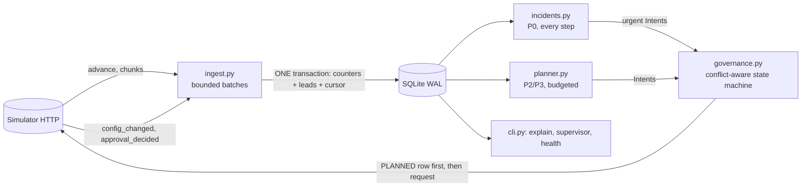

# Outcome-First Agent Loop — Submission

**Name:** [fill in] · **Date:** 2026-11-07 · **Hours actually spent (be honest):** [fill in] · **Language / storage:** Python 3.10 (numpy, httpx) / SQLite (WAL), no new dependencies

> Copy this file to `SUBMISSION.md`. Keep the headings. Be concrete: numbers, examples, diagrams. If a
> section doesn't apply, say why in a line rather than deleting it.

---

## 0. TL;DR
A single-process controller. It keeps per-arm counters from the event stream in SQLite (one transaction per chunk, memory bounded by a batch), runs randomised welcome/voice tests with one deterministic Bayesian rule plus confirmation on fresh data (workflow winners and cohort overrides alike), reopens limited exploration when a promoted arm stops being better, reroutes degraded caller IDs, answers hallucination incidents (previous prompt first, LLM only if needed), and sends every change through an explicit proposal state machine with deterministic ids.
public_01 +9.0% conclusion rate vs baseline (8 changes, 0 harmful); public_02 +25.4% (17 changes, 0 harmful, hallucinated calls 416→209, 5 credits); public_03 +16.5% in 2 min 37 s, 346 MB peak (48 changes, 0 harmful). Whole-policy simulation: 1% false promotion under the null, ~1.1 proposals per run.
Four SIGKILLs mid-run: no duplicate, no lost proposal, one continuous audit trail; identical audit trail across hash seeds. Decision path p99 0.10 s; ingest 94k events/s.
Not built: call-time optimisation, cross-axis cohorts, UI, cross-tenant credit arbitration.
Weakest points: little statistical power at dev scale (6–27% of the engagement headroom); a neutral winner is only recognised once there is enough data to say so, so on small workflows it can stay live for days.

## 1. Assumptions
1. **Welcome message and voice act after pickup**, so they can move engagement but not pickup; only caller ID and *who is dialled when* can move pickup. Pickup-primary workflows therefore get caller-ID work, not welcome/voice tests (I did not build call-time work, §2). Guardrail checks still measure the other KPI for every candidate.
2. **Guardrail `*_max_drop` is an absolute drop in the guardrail rate** (0.02 = two points), checked as P(drop within tolerance) ≥ 0.80.
3. **History carries no variant information**: the default config allocates one welcome message and one voice, so pre-D0 data gives baselines, hour profiles, caller-ID baselines and the hallucination base rate, never option priors.
4. A global hour-weight table is a no-op (it scales every eligible lead equally); only a table that differs between groups changes who is dialled when. I did not build call-time optimisation (§2).
5. Each dial's welcome/voice/caller-ID is sampled independently (per the contract), so marginal arm contrasts are unbiased even when the other dimensions vary. Contrasts are stratified by (config version × cohort) so allocation changes cannot confound them.
6. QA hallucination flags are noisy: baseline is estimated from the workflow's own pre-incident flag rate (false positives included), never assumed to be zero.
7. Validation measures safety only. Engagement after a prompt change is verified from production calls; a fix that hurts engagement is treated as a regression.
8. The approver is a black box with working hours and latency; decision time ≈ next_working(now + latency). Requests that cannot be decided inside their TTL are not sent (they would be guaranteed to expire).
9. Fatigue limit (`max_requests_per_24h`) counts every request, including rejected and expired ones; the controller keeps one slot per 24h in reserve for incidents.
10. A supervisor edit is legitimate and wins: the edited dimensions are put on a 48h hold, experiments are re-derived from the live config, a pending proposal built on an older version is abandoned and re-planned. The one exception is an incident fix, which is *proposed* (never forced) and explains the evidence.
11. Hidden scenarios share the public schema/ranges (≤20 cohorts, 15-minute ticks, same event types and start date). The date of D0 is read from `/sim/state`, never hard-coded.
12. Call-time optimisation (per cohort or per person) was not built. A person has 1–3 connected calls in the horizon, and cohort-level tables only help if hour preference correlates with the lead features, which I could not check from the API.

## 2. Scope decisions
| # | Capability | Status | Why | What finishing it would take |
|---|---|---|---|---|
| C1 | Event ingestion | Built | Streamed NDJSON, one transaction per chunk covering counters, leads and cursor; replay is a no-op; memory bounded by one 60k-event batch; bounded work per loop iteration. | Per-workflow sharding for 100×. |
| C2 | Shared cohort object | Partial | One `cohorts` table and one id scheme (`age_band=60+`) used by experiments, config, audit and the supervisor view. One partition axis per workflow, single-value cohorts only. | Cross-axis cohorts. |
| C3 | History bootstrap | Partial | History gives the KPI baselines, caller-ID baselines and the hallucination base rate. It has no variant information (the default config has one welcome and one voice), so there are no option priors. | Nothing to add until history contains variation. |
| C4 | Call-time optimisation | Not implemented | Removed in review. A global table is a no-op, a per-cohort table depends on hour preference correlating with lead features (unverifiable here), and its measured effect in the public runs was within noise. | Per-person preferred hour, evaluated against a hold-out. |
| C5 | Caller-ID health | Built | Pickup compared between concurrent, randomly assigned caller IDs; flagged ID kept at a floor; untested IDs probed. | Load-aware allocation. |
| C6 | Welcome/voice experiments | Built | Randomised arms, one decision rule (§5). | Interaction model. |
| C7 | Promotion, decay, rollback | Built | 85/15 promotion; rollback when the winner stops clearing the bar against its holdout. Detection is power-limited on small workflows (§13). | A sequential change detector. |
| C8 | Hallucination incidents | Built | Detect, previous prompt first, LLM only if needed, validate, propose with evidence, verify flags and engagement. | — |
| C9 | Governance client | Built | Explicit state machine, deterministic ids, TTL/hours/fatigue-aware submission, stale/abandoned handling. | — |
| C10 | Honest scores/dry runs | Partial | Formulas and fields are real, but the dry run replays the same data that produced the decision. | Replay on a held-out window. |
| C11 | Supervisor view | Partial | CLI (`supervisor`), no web UI. | A JSON endpoint over the same query. |
| C12 | Audit store | Built | Decisions, evidence, route, approval transitions, apply and follow-up are rows; `explain` reconstructs them. | Retention policy. |
| C13 | Crash recovery | Built | Demonstrated with SIGKILL (§9). | — |
| C14 | Observability | Partial | `metrics` table, `health` command, explicit page/no-page list (§10). No exporter. | Prometheus endpoint. |
| C15 | Fair credit/attention allocation | Not implemented | Only incidents spend credits (capped per incident), and the per-workflow request slots protect approvers. There is no cross-tenant arbitration. | A weighted queue across tenants. |

I built the loop end to end and spent the effort on the parts that can hurt a client: governance, the decision rule, incident handling, crash safety, audit. I cut the levers whose evidence I could not defend.

## 3. Stakeholders
### 01 Sales — Nikhil Rao
- **Accepted:** speed where it is safe: rollbacks, harm stops and caller-ID rotations use the fast path; routine batching is minimal; the supervisor view gives a per-client lift table.
- **Declined:** a single blended score (violates the KPI definition and Product's memo); promoting a winner to everyone by evening (we promote 85/15 with a holdout and need evidence first); the "persuasive" prompt (it is the one that raises hallucination risk; prompts only change through an incident fix with validation).
- **Wrong against the contract:** "Kestrel has auto-apply for everything" — `ks_cancel` allows only schedule, caller_id, welcome_message, voice, capped at a 0.2 shift; prompts and cohorts are not allowed. "Northwind is fine with auto-apply on KYC" — `nw_kyc` has auto-apply **disabled**.
- **Reply:** *Nikhil — you'll get a lift figure per client per KPI (pickup, engagement, conclusion), not a blend; blending hides which lever moved. Winners get a provisional half of the traffic, are confirmed on fresh data, and then run at 85% with a 15% holdout so we can prove the lift and catch decay; I won't take it to 100% by evening. Kestrel's policy only auto-applies schedule, caller-ID, welcome and voice within a 0.2 shift, and Northwind KYC has auto-apply off, so those changes go through the approver. The "persuasive" prompt is out unless an incident fix validates it. For the summit I can show the audit trail of one real change end to end.*

### 02 Compliance — Meera Iyer (Northwind)
- **Accepted:** all customer-facing changes (welcome, voice, prompt, cohorts) go through a named approval on Northwind workflows (their policy permits auto only for schedule/caller_id, and we don't auto-apply customer-facing growth moves anywhere); prompt changes carry a validation run; every proposal has diff/dry-run/rationale; `explain` reconstructs variant-and-reason by config version.
- **Declined:** "no customer even briefly worse off" cannot be guaranteed by any experiment; we bound it (harm stops, minimum evidence, control share ≥ 40%) and say so. A per-customer "what did they hear" answer needs the call events (`variant`, `config_version`) held by the platform; our store gives the version-level reason and the lookup key.
- **Wrong/clarify:** approvers work 10–19 (KYC 10–18); a request sent at night is *guaranteed* to expire on a 12h TTL, so we hold such requests until the window opens.
- **Reply:** *Meera — agreed on all five. Anything a customer hears (opening line, voice, script) is proposed to your named approver with the diff, dry run and, for scripts, a validation run; operational changes (timing, caller-ID rotation) are applied within policy and listed in the weekly summary. For an auditor's question we can show, per config version, the variant and the reason it was live; the per-call lookup uses the platform's call event, which carries that version. Experiments are bounded (the incumbent keeps ≥40%, harmful arms are stopped on evidence) but I can't promise zero exposure to a worse variant.*

### 03 Platform/SRE — Kabir Menon
- **Accepted:** kill/restart test (§9), idempotent writes with deterministic proposal ids, no new infrastructure (embedded SQLite file, one process), `health` command, explicit pageable-alert list (§10), 10× analysis (§8).
- **Declined:** reusing Postgres/Redis for now — a single-writer embedded store is enough at this scale and has no 2 a.m. operator; sharding by workflow is the migration path.
- **Wrong/clarify:** none factually wrong; the 10 min/day target is measured in §8.
- **Reply:** *Kabir — killed with SIGKILL four times mid-run (including with approvals pending); it resumed from a durable cursor, never double-applied and kept one continuous audit trail (reports/crash_recovery.md). State is one SQLite file (WAL) written transactionally; no Redis/Postgres needed at this scale, and the 10× plan is to shard workflows across processes with a DB each. `controller.cli health` shows ingest lag, decisions, credits and what is page-worthy; only stuck proposals, escalated incidents, ingest failure and credit exhaustion should page.*

### 04 Client ops supervisor — Anita Desai (Kestrel)
- **Accepted:** her edits are never undone (48h hold on edited dimensions; in-flight proposals go stale and are re-planned); one batched request per workflow, routine requests never before 11:00 and at most 2 a day; one-screen supervisor view; fixes are checked for engagement after rollout (the verbatim-script failure mode).
- **Declined:** "tell me *before* anything changes": changes that go through an approval are announced by the request itself; auto-applied changes are limited to protective moves (rollbacks, caller-ID health, incident fixes where permitted) and appear in the view and digest. We cannot block those without losing the fast path.
- **Wrong/clarify:** Kestrel's policy allows up to 4 requests/24h; her "2 a day, not before 11:00" is stricter and is adopted as our self-imposed routine limit, with incident fixes exempt.
- **Reply:** *Anita — your edits stay: if you change something we hold off that dimension for 48 hours and re-plan around it. You'll get one batched request at a time, never before 11:00, at most two routine requests a day; fixes for a bad prompt are the exception. `controller.cli supervisor` is the one screen: what's being tested, what's winning, what's waiting on you, what changed today. Prompt fixes are re-checked on engagement after rollout, so a safe-but-lifeless script gets flagged. One thing I can't promise: protective changes (rolling back a decayed winner, rotating a bad caller ID) may apply without a prior request.*

### 05 Product — Tara Kulkarni
- **Accepted:** pickup/engagement/conclusion never blended; one cohort object (`cohorts` table, same id in config, experiments, audit and view); minimum sizes with the cost stated (§5); proposals carry impact/diff/affected/dry-run with a documented formula; only observed exposure counts (evidence = recorded calls by variant and version); a winner changes that workflow only.
- **Declined:** per-person call-time as P0 (not built, assumption 12); treating an expired proposal as a bare rejection — we do treat it as a non-decision, wait for a cooldown and re-propose with *fresh* data and a new id, never the stale body.
- **Wrong/clarify:** "ranking the queue by impact" works only if the score is comparable across workflows; ours is bounded and based on expected lift × population × confidence.
- **Reply:** *Tara — held to all your definitions: pickup, engagement and conclusion are separate everywhere; one cohort object with one id across detection, experiments and the supervisor view; only calls that actually ran count as evidence. A cohort needs ≥8% of traffic and ≥200 trials per arm-slice, which costs days of speed to avoid false winners. Impact score = 1−exp(−(expected relative lift × share affected × confidence)/0.03), bounded in [0,1], so it ranks. Call-time optimisation (per person or per cohort) and a web UI are not built; caller-ID health and the supervisor CLI are in.*

### 06 CTO — Aryamann
- **Accepted:** choose and say no; spend credits only where they change a decision (5 credits in public_02: one validation, no LLM call because the last-good prompt validated); trust the contract over memos; documentation for the on-call.
- **Declined:** nothing to decline; this memo is a rubric.
- **Reply:** *Aryamann — understood. Not built: call-time optimisation, cross-axis cohorts, UI, cross-tenant arbitration. Built end to end: ingest, experiments with rollback, caller-ID health, incident loop, governance, audit, crash recovery. Public_02 spent 5 credits: the last-good prompt was free to propose and needed one validation. What breaks first at 10× is the single-process aggregation of one workflow's chunks; the plan is per-workflow sharding.*

## 4. Architecture

**Fast path** (durable): fetch → decode → extract → aggregate → one commit of counters and cursor. **Decision path**: reads committed counters only, never events.
One loop iteration, in priority order, each part bounded:
| priority | work | bound |
|---|---|---|
| P1 | ingest unread chunks | ≤4 chunks per iteration; the simulator is not advanced while anything is unread |
| P0 | reconcile proposals: poll approvals, apply approved, abandon stale | all open proposals (a handful) |
| P0 | incident detection / verification / fix proposal | every workflow, ~2 ms |
| P2/P3 | welcome/voice tests, decay watch, caller-ID health | only when there is no backlog; ≤8 workflows per iteration, oldest first |
Under backlog, ingestion gets every iteration and routine optimisation pauses; safety work still runs. Nothing is dropped, because the cursor advances only on commit.
| module | why it exists |
|---|---|
| `ingest.py` | Events → additive counters. Leads are rows in SQLite (not a resident map): features for a batch come from one `IN (…)` query. numpy does the group-by (≈3.7× faster than pure Python; ≈15% end-to-end, `reports/performance.md`). |
| `store.py` | Schema with `CHECK` constraints on proposal/incident state, indexes for the hot queries, `tx()`, `audit()`. The only durable state. |
| `evidence.py`, `stats.py` | Read-side queries and a few closed-form functions; no randomness. |
| `planner.py` | Welcome/voice tests and caller-ID health: pure functions of (counters, live config, small experiment memory). |
| `incidents.py` | Detection and the fix workflow; the only place credits are spent. |
| `governance.py` | The only code that calls `/approvals`, `/apply`, `PUT /config`. |
| `main.py` | The loop, work budgets, supervisor-edit detection. |
The remote config is authoritative: it is re-fetched every step and every proposal is built as *live config + the intended diff*. On restart: reopen the DB, read `/sim/state`, ingest from the cursor, refresh configs, then `reconcile` (§6). A DB that belongs to a different simulator world is moved aside, never reused. Workflow-keyed state is separable; the genuinely global pieces are the credit balance (spent only in `incidents.py`), the world key and the event cursor.

## 5. The learning loop
**Plain terms.** For each lever (welcome message, voice) the controller keeps successes/trials per arm, per config version and cohort. An arm is compared with its control: the difference of two Beta posteriors (prior = the workflow's own historical rate, weight 4), approximated as normal. Decisions use only three probabilities:
* *clears the bar*: P(arm − control > the practical lift);
* *better*: P(arm − control > 0);
* *harmful*: P(arm − control < −the harm bar).
**Effect sizes are explicit.** Practical lift = max(3% **relative** to the control rate, 0.5 **points**); harm bar = max(2% relative, 0.33 points). The absolute floor matters near 0% and 100%: at a 1% rate "3% relative" would be 0.03 points of nothing. Near the edges the normal approximation is also unusable, so every arm needs ≥10 successes **and** ≥10 failures (`min_events`) as well as ≥250 trials. The denominator is always the KPI's own: engagement = engaged/connected, pickup = connected/dials.

**Lifecycle of a lever (the same machinery for the workflow and for each cohort override)**
```
EXPLORING --win--> CONFIRMING --fresh data: P(better) >= 0.90--> PROMOTED
     ^                 |                                             |
     |  fresh P(better) <= 0.10, or severe regression                 |  still beneficial ............ stay
     +-----------------+                                             |  no longer beneficial ........ REOPEN (incumbent keeps 70%)
     +------------------------------------------------------------- |  worse / harmful / guardrail .. ROLL BACK to the control
EXPLORING --P(harm) >= 0.99--> that arm is removed for the rest of the run
```
* **Win** (first look): ≥250 trials and ≥10 events of each kind in both arms, P(clears the bar) ≥ 1 − 0.05/(challengers), guardrail KPI not credibly breached. Several winners are ranked by lower credible bound.
* **Provisional split:** the winner gets half the traffic; the control and every challenger not yet ruled out keep the rest.
* **Confirm** on data collected after the provisional split only: P(better) ≥ 0.90 and the guardrail holds → 85% winner / 15% control holdout.
* **Three outcomes for a promoted arm, three different actions**, judged against its holdout:
  * *still beneficial* (P(clears the practical bar) > 0.2): keep;
  * *no longer beneficial* (P(clears the bar) ≤ 0.2 but P(better) > 0.10: not worse, just not worth its place): **reopen limited exploration**: the arm stays the incumbent/control at 70%, the other options (including the old control) share 30%, through the normal provisional → confirm lifecycle, so a better arm can be discovered and a false alarm costs only a mild 30% challenge;
  * *worse or harmful* (P(better) ≤ 0.10, credibly harmful, or the guardrail credibly breached): roll back to the control.
  A neutral winner used to freeze the lever, because only the winner and the control received traffic.
* **Evidence-driven timing.** Demotion is judged on the smallest trailing window of at least one full day (the dialling-hour mix) that holds ≥250 trials in both arms: a busy workflow reacts after a day, a quiet one waits for evidence, not for a clock.
* **Safety path.** A promoted arm more than 10% (relative) below its holdout, or collapsing the guardrail, with P ≥ 0.99 on ≥100 trials over the last two blocks, is rolled back immediately. Two paths only: optimisation (conservative, confirmed) and safety (fast, only for large effects).
* **Harm stop:** an arm credibly worse than control (P ≥ 0.99, stronger than other decisions because the stop lasts the run) is removed. Re-offering a stopped arm would cost more than the rare false stop it repairs.
* **Evidence labels** (supervisor view): `INSUFFICIENT` (not enough data: *unknown*), `UNDECIDED`, `NO_PRACTICAL_EFFECT` (every challenger measured and none credibly clears the bar), `DECIDED`. "No winner yet" is never reported as "no effect".

**Why these are not flapping.** Entering needs ≥0.98 then 0.90 on independent data; rolling back needs P(better) ≤ 0.10 on fresh data (provisional) or on a full day and ≥250 trials (promoted); a rolled-back arm is benched 3 days; a reopened exploration restarts the whole lifecycle with the incumbent as control. A neutral arm needs two independent positive results to get in and an adverse result to get out.

**What the probability is.** The 0.05 is a *Bayesian posterior tail threshold*, split by Bonferroni across the challengers compared at one look. It is **not** a classical type-I-error guarantee: the same experiment is examined repeatedly. What I claim is what I measured.
*Stage level* (`scripts/false_winner_sim.py`; stage 1 = up to 8 looks of 150 connected calls per arm, stage 2 = up to 6 fresh looks):

| true situation | first-look promotion | confirmed promotion |
|---|---|---|
| all arms identical, 1 challenger | 3.5% | 0.5% |
| all arms identical, 3 challengers | 4.8% | 0.6% |
| one challenger +6% relative | 35.8% | 17.9% |
| one challenger +10% relative | 75.6% | 60.9% |
| one challenger +10% of 3 | 53.5% | 42.0% |

*Whole policy* (`scripts/policy_sim.py`: the real planner run through 8 simulated days, planner every 12 h, approvals instantaneous, 300 runs per row; full tables in `reports/policy_operating_characteristics.md`). Static better arm:

| true relative lift of the better arm | calls/day | provisional win | **confirmed (false if +0%)** | confirmed by day 3 | by day 8 | median days to confirm | confirmed arm later rolled back | proposals / workflow |
|---|---:|---:|---:|---:|---:|---:|---:|---:|
| +0% | 1000 | 3% | 1% | 1% | 1% | 3.0 | 0% | 1.1 |
| +0% | 4000 | 2% | 0% | 0% | 0% | 3.0 | 0% | 1.1 |
| +10% | 300 | 0% | 0% | 0% | 0% | - | - | 0.0 |
| +10% | 1000 | 68% | 54% | 3% | 54% | 5.0 | 1% | 2.3 |
| +10% | 4000 | 100% | 99% | 57% | 99% | 3.0 | 0% | 3.2 |
| +20% | 1000 | 100% | 100% | 26% | 100% | 3.5 | 0% | 3.0 |

* Under the null the whole policy confirms a false winner in 0–1% of runs and spends ~1.1 proposals per workflow per run (essentially the initial exploration request): no approval spam.
* A +10% lift is confirmed in 99% of runs at 4,000 connected calls/day (median 3 days) and 54% at 1,000/day; +20% at 1,000/day in 3.5 days; +2% is below the practical bar and almost never acted on; at 300/day the planner declines to start a test it cannot finish.

The promoted arm's world changes on day 4 (arm +10% before):

| what changes | calls/day | promoted before | **acts** after the change | median days to act | action | **new better arm found** | median days to find | false rollback before the change | proposals / workflow |
|---|---:|---:|---:|---:|---|---:|---:|---:|---:|
| V2 collapses to −15% | 1000 | 19% | 100% | 1.5 | rollback 72% / reopen 28% | n/a | - | 0% | 2.1 |
| V2 collapses to −15% | 4000 | 79% | 98% | 0.5 | rollback 64% / reopen 34% | n/a | - | 0% | 4.2 |
| V2 decays to the control rate | 1000 | 17% | 63% | 2.0 | rollback 13% / reopen 50% | n/a | - | 0% | 1.9 |
| V2 decays to the control rate | 4000 | 79% | 94% | 1.0 | rollback 20% / reopen 74% | n/a | - | 0% | 3.5 |
| V2 → neutral, V4 becomes +10% | 1000 | 17% | 87% | 2.0 | rollback 13% / reopen 73% | 0% | - | 0% | 2.0 |
| V2 → neutral, V4 becomes +10% | 4000 | 75% | 96% | 1.0 | rollback 14% / reopen 82% | 42% | 3.0 | 0% | 4.2 |
| V2 → −10%, V4 becomes +12% | 1000 | 15% | 100% | 1.5 | rollback 48% / reopen 52% | 5% | 4.0 | 0% | 2.1 |
| V2 → −10%, V4 becomes +12% | 4000 | 75% | 99% | 0.5 | rollback 47% / reopen 51% | 95% | 2.0 | 0% | 5.2 |

* **Collapse to −15%:** acted on in 98–100% of runs, at a median of 0.5 days (4,000/day) to 1.5 days (1,000/day). About a third of those first show up as "no longer clearly better" while the window still mixes old and new data, so the first action can be the reopen (arm to 70%) with the rollback or replacement following; the arm is never left at 85%.
* **Decay to the control rate:** previously a flat winner was rolled back in only 31–47% of runs and never reopened exploration; now exploration is reopened in 74% of runs at 4,000/day (median 1 day) and 50% at 1,000/day.
* **A different arm becomes better:** found in 42% (neutral winner) to 95% (old winner turned bad) of runs at 4,000/day, median 2–3 days, within the 4 days left after the change; at 1,000/day it is rarely found inside the horizon (0–5%): the evidence does not accumulate fast enough. False rollback of a good arm before the change: 0%.

A harmful arm in the mix:

| calls/day | calls served by the harmful arm | harm-stopped by day 8 | median days to stop | confirmed V2 by day 8 |
|---:|---:|---:|---:|---:|
| 300 | 0.0% | 0% | - | 0% |
| 1000 | 11.4% | 36% | 3.5 | 51% |
| 4000 | 4.4% | 44% | 2.0 | 100% |

At 1,000 calls/day a harmful arm serves ~11% of calls before the test ends or the arm is stopped (it has to be measured to be stopped); at 4,000/day ~4%.

**Minimum sample.** `min_trials_arm = 250` is a heuristic floor against very early posterior noise and approval churn, plus `min_events = 10` for approximation validity. It is not a power calculation.

**Cohorts.** One partition axis per workflow (one lead feature, chosen when the first cohort is justified), single-value cohorts (`age_band=60+`), so cohorts never overlap. A cohort override is proposed only if some option beats the workflow-wide action inside that slice under the same rule, Bonferroni over every (slice, option) pair examined, ≥8% of traffic, ≥200 trials per arm, gain ≥0.4 points, options already harm-stopped excluded, at most 6. It then goes through the **same provisional → confirm lifecycle** as a workflow winner; if it does not replicate, the cohort falls back to its own control (never to the default allocation, which may be an exploration mix). Otherwise the controller stays at workflow level.

**Welcome × voice.** Both are explored in the same stream of calls; the simulator samples each dimension independently, so each marginal comparison is unbiased and I did not model the interaction. Contrasts are stratified by config version, so allocation changes and other levers' changes cannot bias them (tested with a constructed Simpson's-paradox case).

**Caller ID.** Every dial's caller ID is random, so concurrent IDs are directly comparable. An ID is flagged only if, over 36 hours and ≥200 dials, its pickup is significantly below its siblings' pooled rate (one-sided z, Bonferroni over IDs, ≥15% relative drop). **An ID without 200 dials is unmeasured, not healthy**: it stays at an 8% probe share. If all IDs degrade together nothing is flagged (siblings are the reference) and nothing is reshuffled. A flagged ID is held at a 3% floor; it is rehabilitated only on ≥300 dials **dialled under the config that cut it** (the version boundary, not the clock, separates before from after: an earlier version of this check leaked pre-flag dials and restored a bad ID).

**What each mechanism prevents**
| mechanism | failure it prevents |
|---|---|
| 250 trials, 10 events, absolute lift floor | decisions on a handful of calls; meaningless relative lifts near 0%/100% |
| Bonferroni over challengers | picking the luckiest of several arms at one look |
| stratification by version × cohort | bias when allocation changes mid-test (Simpson) |
| provisional split + confirmation (workflow and cohort) | winner's curse and premature collapse of exploration |
| symmetric rollback, three-way outcome, full-day evidence-driven window | flapping; slow quiet workflows being judged on noise; a neutral winner freezing the lever |
| safety path | a severe regression waiting for the optimisation-grade evidence bar |
| guardrail check at decision (workflow *and* cohort first look), confirmation and during monitoring | winning on the primary KPI while hurting the other |
| harm stop at 99% | continuing to serve a credibly worse arm |

**Policy values.** A = contract, B = business policy, C = derived, D = heuristic. All are in `controller/policy.py` beside their class.
| value | class | reason |
|---|---|---|
| tail_prob 0.05 split by Bonferroni; confirm 0.90; harm 0.95 (stop 0.99); safety 0.99 | D | credibility levels, behaviour measured above, not claimed as an error rate |
| 3% relative / 0.5-point lift floor; 2% relative / 0.33-point harm | B | smaller effects are not worth an approval or a rollback |
| 250 trials per arm (200 per slice), 10 events | D / C | heuristic floor; approximation validity |
| 50% provisional, 85/15 promoted | B/D | easy to reason about; kept fixed on purpose: an adaptive holdout adds a parameter that cannot be validated at this volume |
| 40% incumbent share in a fresh test; 70% when the incumbent has a record (a supervisor's choice, or a promoted winner that stopped improving) | D | the control must keep enough data; a record is a prior in the incumbent's favour |
| ≥1 day demotion window, 10% relative severe drop on ≥100 trials | D | diurnal cycle; large effects need less data |
| cohorts ≥8% share, ≥0.4pt, ≤6 | D | a cohort must pay for itself |
| 48h supervisor hold; routine ≥11:00, ≤2/day; 1 request slot per 24h kept for incidents | B | memo / policy |
| caller ID 15% drop, 3% floor, 8% probe, 12h between changes | B/D | |
| 4 chunks and 8 workflows per iteration; 12 outage retries | D | bounds one iteration to ~15 s of ingest and ≤0.2 s of planning |
| max requests per 24h, TTL, approver hours, apply window | A | workflow policy |

## 6. Governance
```
PLANNED --sent--------> PENDING --approved--> APPROVED --apply--> APPLIED
   |  \--auto route (PUT /config)---------------------------------> APPLIED
   |                      |  \--rejected--> REJECTED      APPROVED --410--> LAPSED
   |                      |  \--expired---> EXPIRED       APPROVED --409 stale--> STALE
   \--> ABANDONED <------+------------- (base moved while waiting, or superseded by an urgent change on the same dimension)
   \--409 stale / 403 refused / unrecoverable--> STALE | REFUSED | FAILED
```
The table is `TRANSITIONS` in `governance.py`; every state change goes through one function that raises on an illegal move, and the database has a `CHECK` on the state column. Terminal states are re-planned from fresh evidence and the current base version, under a new id.

**Concurrency model.** Every proposal is built as *live config + intended diff* and records the dimensions it changes.
* A routine proposal is never sent while anything else is in flight for the workflow.
* An urgent proposal (incident fix, rollback, withdrawal) may be sent alongside a routine one only if their dimensions are **disjoint**; if they overlap, the routine proposal is abandoned (superseded). Only one urgent proposal per workflow at a time.
* Disjoint proposals still share one base version, so the second one to apply gets 409 `stale_base_version` → `STALE` → re-planned. The set-intersection rule decides who yields; the version check serialises the writes.
* A supervisor edit: remote state wins. The pending proposal built on the old version becomes `ABANDONED`, new plans start from the new config, the edited dimension is held 48 h.

**Identity.** `pid = <workflow>-v<base>-<sha1 of proposed config>[-rN]`, written as `PLANNED` before any request.

**Crash matrix** (what happens if the process dies around each side effect):
| side effect | dies before the request | dies after the server accepted it, before our commit |
|---|---|---|
| `POST /approvals` | `PLANNED` row, not in `/approvals` → resend same id | found in `/approvals` by proposal id → adopted |
| `PUT /config` (auto) | `PLANNED` → resend same id (a 403 does not consume the id) | found in config history by proposal id → `APPLIED` |
| `POST /apply` | `APPROVED` → apply again | 409 `not_approved`; approval says `applied` → version looked up in history |
| `POST /sim/advance` | nothing happened | state re-read; never resent blindly |
| validation / LLM (credits) | nothing recorded → run once | the result is lost (the API cannot return a past run). On restart the controller notices the simulator balance is below its ledger and writes a `credit_spend_unrecorded` audit row; the next attempt spends again. Not fixable without an API change. |

**Timing.** A *routine* request whose worst-case decision time (`next_working(now + max_latency)`) falls after its TTL could expire, so it is held until the approver window opens. An *urgent* safety fix is sent if the **fastest** approver could still decide in time: waiting is expensive there, and the downside (an expired request) costs only the incident slot that is reserved for exactly this. On public_02 this turned a rejected first attempt into a retry the same step (MTTR 435 min instead of 1,365). Routine requests wait until 11:00, at most two a day; one of the 24h request slots is kept for incidents; while anything is pending the loop advances 15 simulated minutes at a time so the 2h apply window is not missed. A rejected or expired change is retried after 6 hours, at most 3 times, under a new id and fresh data.

**Auto-apply.** Only if the policy enables it, every changed dimension is allowed, the total-variation shift is within `max_shift`, and the change is operational (caller ID) or protective (rollback, withdrawal, harm stop, incident fix). Welcome, voice, cohorts and prompt growth moves always go to a human, even where the policy would allow auto-apply (Compliance and Kestrel asked to be told first).

**Proposal fields.** `affected_leads` = live leads in the changed scopes (SQL count by feature). `dry_run` = recorded outcomes of the randomised arms replayed under old and new allocation with a 95% interval; per-ID pickup for caller IDs; the validation run for prompts. `impact_score` = `1 − exp(−(expected relative lift × share affected × confidence)/0.03)` ∈ [0,1], incident fixes ≥0.9. The dry run reuses the data that produced the decision: it is a consistency check, not an out-of-sample estimate. Every proposal record also stores the thresholds in force.

## 7. Incidents
* **Detection.** Flag rate of connected calls on the current prompt since the version that introduced it, against the workflow's own earlier flag rate b0 (false positives included). **b0 is a trailing 7-day rate excluding periods that were themselves incidents**, so slow drift is followed and an old incident cannot teach the detector that a bad rate is normal. Open when n ≥ 150, ≥5 flags, P(X ≥ k | p₀ = 1.25·b0 + 0.001) < 0.001, and rate ≥ 2·b0, on two looks ≥45 min apart. One flagged call cannot open one; a burst that subsides, or a rate at baseline, cannot (tested). One incident per workflow at a time; different workflows are independent and share only the credit balance.
* **Fix.** (1) A prompt this workflow ran before, whose production flag rate was within baseline, is the first candidate and costs nothing to nominate; (2) each candidate gets one validation run (n=500, 5 credits) and must clear `min_validation_pass_rate`; (3) only if none passes: one LLM call (3 credits, ≤2 rounds), ≤3 suggestions validated, the current prompt validated once as a reference; the LLM is untrusted: malformed, duplicate or unknown suggestions are ignored (tested) and nothing unvalidated is ever proposed; (4) otherwise escalate. With too few credits the incident escalates instead of looping (tested). After the fix lands: the flag rate must fall and engagement must not be credibly more than 7% below the earlier prompts.
* **public_02, ks_cancel (final run, from the audit store):**
| sim time | event |
|---|---|
| D2 10:00 | (simulator) a caller ID is flagged; rerouted within the day: its share of dials 33.4% on D2 → 3.3% on D3 |
| D3 11:30 | supervisor ships prompt P2 (observed as config v5 at 11:45) |
| D3 14:45 | incident opened: 20/298 = 6.7% flagged vs 1.5% baseline; previous prompt P1 validated 0.986 on n=500 (5 credits, no LLM); proposal sent in the same step |
| D3 16:00 | approved and applied. **MTTR 270 min** |
| D3 19:00 | verified: 4/272 = 1.5% flagged, incident closed |
* **Where the time goes.** ~195 min detection (the statistical sample plus the 45-minute second look), <1 min validation, ~75 min approver latency (20–120 min, policy). If the approver randomly rejects the first request (5% base rate) the fix is re-submitted in the same step: 435 min in an earlier run of the same incident, versus 1,365 min before urgent requests used best-case latency. Detection and the retry rule are controller-controlled; approver latency and rejections are not, and no public policy lets a prompt be auto-applied.

## 8. Scale
Measured on public_03_load (`reports/load_test.md`, `reports/performance.md`): the whole run — 7 history days + 5 live days, 12 workflows, 9.74 M events, simulator on the same box — took **2 min 37 s** (≈ 31 s per live simulated day against the 10-minute budget). Ingest 90k events/s (mean over ingest time, max 174k). Decision path per step: mean 0.04 s, p95 0.07 s, p99 0.105 s, max 0.144 s; ingestion is bursty (max 11.2 s for a step that reads four chunks). Peak RSS **346 MB**, DB 100 MB, 0 HTTP errors, backlog high-water 19 chunks (history bootstrap), drained in 5 iterations. The behavioural changes in the last pass left these unchanged.
**Memory** does not grow with leads or events: leads live in SQLite (the old resident map cost 128 bytes per lead), so RSS is flat at one batch plus the interpreter. Synthetic 10× shape (120 workflows, 7.7 M events/day, labelled synthetic): 87k events/s, 287 MB (previously 67k events/s, 1,125 MB). Work per iteration is bounded (4 chunks, 8 workflows), routine planning is round-robin by staleness (tested), so one hot workflow cannot starve others.
**At 10×** the first limit is a single SQLite writer and one decode core (≈97 s of ingest per simulated day, still far below real time), then DB size (leads ≈ 1 GB / 12 days, pruned past the cadence window), then planner time (linear in workflows, capped per step). Path beyond that: `workflow_id → shard`, one worker and DB per shard; only the credit balance and the event cursor cross workflows. Not built: Kafka or distributed workers.

## 9. Reliability
* **Method.** `scripts/crash_demo.py`: serve public_02, run the controller, SIGKILL it at random moments (4 kills), restart against the same DB each time, then check against the simulator that no proposal id was submitted twice, no approval or proposal produced two versions, every locally `APPLIED` proposal exists in the simulator and vice versa, and the run finished.
* **Result (`reports/crash_recovery.md`):**

scenario `02_incidents`, SIGKILL x4, seed 7

- kill 1: sim 2027-01-04T10:00:00+05:30, event cursor=1, open proposals at kill=[]
- kill 2: sim 2027-01-05T12:15:00+05:30, event cursor=47, open proposals at kill=[]
- kill 3: sim 2027-01-08T07:45:00+05:30, event cursor=118, open proposals at kill=[('nw_kyc-v2-ae126aeb8cfc', 'PENDING')]
- kill 4: sim 2027-01-09T01:30:00+05:30, event cursor=146, open proposals at kill=[('nw_renewal-v6-5baff4e24601', 'PENDING'), ('nw_kyc-v3-df5872b2ac0e', 'PENDING')]
- final run exit code 0

- controller starts recorded in audit: 5 (4 restarts)
- approvals in simulator: 15, unique proposal ids: 15
- proposals by local state: {'APPLIED': 15, 'REJECTED': 2, 'ABANDONED': 1}
- audit rows: 101 (continuous across restarts)
- scenario finished: True
- **violations: none**

* **Failure matrix** (every row has a test unless marked):
| failure point | behaviour | test |
|---|---|---|
| before a chunk is fetched / stream dies mid-chunk | nothing committed; the same chunk is re-read | `test_crash_mid_chunk_rolls_back...` |
| after fetch, before commit | replayed from the durable cursor | same |
| counters written, cursor not | impossible: one transaction | by construction |
| duplicate chunk or events | skipped by `last_event_id`; counters unchanged | `test_duplicate_chunk_is_idempotent` |
| gap in event ids | `ingest_gap` audit row (paging) | — |
| malformed event line | skipped, counted, audited (`ingest_malformed`) | `test_ingest_counts_and_joins_features` |
| proposal row written, request not sent | resent under the same id | `test_server_error_on_submit...` |
| server accepted, response lost | found in `/approvals` by id and adopted | `test_crash_after_server_accepted...` |
| approved but not yet applied locally | reconcile applies once; 409 `not_approved` → history lookup | `test_apply_timeout...` |
| base moved while pending/approved | `ABANDONED` / `STALE`, re-planned from the live config | `test_supervisor_edit_while_pending...`, random model test |
| approval expired / lapsed / rejected | terminal, never applied | `test_rejected_or_expired...`, `test_apply_after_the_window_lapses...` |
| credit charged, result not stored | detected on restart (`credit_spend_unrecorded`), **not recoverable** | `test_unrecorded_credit_spend...` |
| simulator unreachable | bounded retries, then 2^n s backoff (≤30 s) for up to 12 iterations, then exit code 2 with state intact | `test_long_outage...`, `test_short_outage...` |
| disk full / SQLite error | the transaction rolls back, the cursor does not advance, the process stops (fail closed); nothing external happens on uncommitted state | by construction |
| different simulator world, same directory | old DB moved aside (also when it has no recorded key) | `test_world_switch...` |
| random sequences of plan / approve / reject / expire / supervisor edit / restart | 40 seeded runs: no double apply, no duplicate submission, no applied terminal proposal | `test_random_interleavings...` |
* **What "crash safe" means here.** A killed *process* cannot leave a half-applied chunk or lose a persisted proposal (SQLite WAL, one transaction per chunk, write-ahead proposal rows). It does not cover disk failure or corruption, and a power loss can lose the last un-synced commit (`synchronous=NORMAL`) — consistency holds and the cursor replays that chunk. The only real loss window is credit-charged results.
* **Simulator errors.** Reads retry with bounded backoff on connection errors and 5xx (connect 5 s, read 120 s); side-effecting calls are never blindly retried. 409 `stale_base_version` → `STALE`; 410 → `LAPSED`; 403 → `REFUSED`; 402 → skip and escalate; 409 `finished` → clean exit; deterministic 4xx are not retried.

## 10. Audit & observability
Everything the controller decides is a row. "Why did ks_cancel change on D3, who approved it, what happened next?":
```
$ python -m controller.cli --db controller_state.db explain --wf ks_cancel --at "D3 20:00"
[ks_cancel] config v6 went live at 2027-01-07 16:00 (D3) (route: approval; dims: prompt_version)
  WHY    : Replace prompt P2 with P1 (hallucination flag rate 6.7% vs 1.5% baseline)
           Incident inc:ks_cancel:P2:v5: 20/298 connected calls flagged on P2. P1 validated at pass_rate 0.986 (n=500, policy floor 0.97); it ran in production before with a flag rate within baseline.
  CHANGE : {"prompt_version": {"from": "P2", "to": "P1"}}
  SCOPE  : affected_leads=7500  impact_score=1.0  base_version=5
  DRY RUN: {"prompt_fix": {"method": "validation run (synthetic conversations, safety only)", "n": 500, "pass_rate": 0.986, "current_prompt_production_flag_rate": 0.0671, "engagement_effect": "not mea
  TIMELINE (from controller audit):
    2027-01-07 14:45 (D3)  proposal_planned     [controller] Replace prompt P2 with P1 (hallucination flag rate 6.7% vs 1.5% baseline)
    2027-01-07 14:45 (D3)  proposal_submitted   [controller] approval apr_00009 requested; expires 2027-01-08T02:45:00+05:30
    2027-01-07 16:00 (D3)  proposal_approved    [client_approver] approved by client approver at 2027-01-07T15:38:00+05:30; apply by 2027-01-07T17:38:00+05:30
    2027-01-07 16:00 (D3)  proposal_applied     [controller] config v6 live
    2027-01-07 16:00 (D3)  incident_fix_applied [controller] prompt P1 live at v6; verifying
    2027-01-08 16:30 (D4)  followup             [controller] 24h after apply: engagement_rate pre 0.5095 -> post 0.4911 (descriptive; not causal)
  THRESHOLDS: tail_prob=0.05, min_relative_lift=0.03, min_absolute_lift=0.005, harm_relative_drop=0.02, min_trials_arm=250, confirm_prob=0.9, holdout_share=0.15, provisional_share=0.5
  EVIDENCE inc:ks_cancel:P2:v5:fix:P1: {"incident": "inc:ks_cancel:P2:v5", "detection": {"prompt": "P2", "since_version": 5, "flagged": 20, "connected": 298, "rate": 0.0671, "baseline_rate": 0.0151, "
  WHAT HAPPENED NEXT:
    2027-01-07 17:00 (D3)  followup           24h after apply: engagement_rate pre 0.5238 -> post 0.5095 (descriptive; not causal)
    2027-01-07 19:00 (D3)  incident_resolved  flag rate 4/272=1.5% after fix (was 6.7%); incident closed
    2027-01-08 13:30 (D4)  proposal_applied   config v7 live
    2027-01-08 16:30 (D4)  followup           24h after apply: engagement_rate pre 0.5095 -> post 0.4911 (descriptive; not causal)
```
`explain` also prints the thresholds in force, the per-option verdicts (the alternatives and why they lost), the config diff and the approval timeline. Five decisions from the final runs reconstruct from it alone: a provisional promotion, its confirmation, a decay rollback (the full W3 lifecycle on nw_renewal), a caller-ID reroute and the incident fix. Other views: `supervisor` (including the evidence labels), `proposal <id>`, `log`, `health`:
```
=== Controller health @ 2027-01-14 00:00 (D10) ===
  metric                          last      mean      p50      p95      p99       max  n
  t_ingest_seconds               0.005     0.016    0.010    0.033    0.041     1.585  484
  t_governance_seconds           0.007     0.009    0.008    0.014    0.022     0.032  484
  t_incident_seconds             0.000     0.000    0.000    0.001    0.001     0.009  484
  t_planning_seconds             0.000     0.005    0.000    0.026    0.033     0.041  484
  decision_lag_seconds           0.008     0.014    0.010    0.035    0.042     0.055  484
  step_seconds                   0.013     0.030    0.024    0.060    0.070     1.599  484
  stage_fetch_seconds            0.002     0.005    0.004    0.008    0.012     0.188  244
  stage_decode_seconds           0.002     0.007    0.002    0.008    0.016     0.823  244
  stage_transform_seconds        0.000     0.003    0.001    0.004    0.005     0.257  244
  stage_aggregate_seconds        0.001     0.003    0.002    0.004    0.005     0.163  244
  stage_db_seconds               0.002     0.004    0.003    0.005    0.007     0.117  244
  ingest_events_per_sec          23414     32798    25518    71716   173530    194417  244
```
Metrics are cheap counters taken once per step, never per event. **Page on:** a proposal stuck `PLANNED` > 2 h, `incident_escalated`, `credit_skip`, `credit_spend_unrecorded`, `ingest_gap`, `sim_outage`/`controller_giving_up`, ingest not advancing for 30 minutes, process down. **Do not page on:** rejections and expiries (re-planned), `deferred` (waiting for the approver), supervisor edits, single HTTP failures, rollbacks, backlog during start-up.

## 11. Results
Baseline: no-op controller on the same scenario. Reports in `reports/`.

**public_01** — 8 changes: 6 beneficial, 2 neutral, **0 harmful**. 7 approved, 1 auto-apply, 0 rejections, 0 credits.

| workflow | conclusion rate | Δ | pickup | Δ | engagement | Δ | engagement gap captured | hallucinated calls (base) |
|---|---|---|---|---|---|---|---|---|
| ks_cancel | 0.356 | +6.9% | 0.244 | +2.3% | 0.508 | +3.5% | 12% | 62 (47) |
| nw_kyc | 0.439 | +20.9% | 0.282 | +16.5% | 0.605 | +2.4% | 0% | 26 (21) |
| nw_renewal | 0.440 | +4.7% | 0.279 | +5.7% | 0.543 | -0.5% | 6% | 51 (42) |
| ALL | 0.402 | +9.0% | 0.263 | +6.2% | 0.541 | +2.1% | 6% | 139 (110) |

**public_02** — 17 changes: 14 beneficial, 3 neutral, **0 harmful**. 15 approved, 2 judgement-call rejections, 3 auto-applies, 5 credits, incident MTTR 270 min.

| workflow | conclusion rate | Δ | pickup | Δ | engagement | Δ | engagement gap captured | hallucinated calls (base) |
|---|---|---|---|---|---|---|---|---|
| ks_cancel | 0.348 | +40.4% | 0.233 | +26.6% | 0.511 | +7.2% | 41% | 104 (330) |
| nw_kyc | 0.466 | +24.2% | 0.291 | +20.2% | 0.605 | +2.2% | 0% | 37 (31) |
| nw_renewal | 0.487 | +14.2% | 0.290 | +10.9% | 0.558 | +1.9% | 14% | 68 (55) |
| ALL | 0.419 | +25.4% | 0.264 | +18.9% | 0.549 | +3.6% | 27% | 209 (416) |

**public_03** — 48 changes: 33 beneficial, 15 neutral, **0 harmful**; conclusion rate +16.5%, pickup +8.3%, engagement +5.3%; 50 approval requests over 12 workflows × 5 days, at most 3 per workflow per 24 h (per-workflow table in `reports/public_03.md`).

**Defects found by reading harmful changes, all fixed as general rules** (none remain in the final runs):
1. *Caller-ID "re-spread" onto unjudged IDs*: IDs with <200 dials were counted healthy. Fixed: unmeasured ⇒ probe share.
2. *Premature promotion of a first-look winner* (public_03): a voice promoted four hours in; its later data showed no effect and a better arm was starved. Fixed: provisional split + confirmation on fresh data.
3. *Promote/demote flapping*: a winner confirmed at 11:00 was demoted at 13:00 on 140 control calls. Fixed: demotion needs a full day and the promotion sample.
4. *Asymmetric hysteresis*: confirmation needed P(better) ≥ 0.90 but demotion only "not clearing the 3% bar", so good arms were rolled back. Fixed: demotion mirrors confirmation (false rollback of a good arm: 4–10% → 0–1% in simulation).
5. *Re-exposure of a harm-stopped arm* inside a protective rollback. Fixed: harm stops need 99% evidence and are kept; the re-offer machinery was deleted.
6. *Cohort rollback to an exploration mix.* Fixed: a cohort falls back to its own control.
7. *Recovery check leaking pre-flag dials* (found when a recovery fix started to work): recovery evidence now comes only from versions at or after the cut.
8. *Incident submission on worst-case approver latency* delayed a safety fix by ~16 hours. Fixed: urgent fixes use best-case latency.
9. *Malformed LLM output* (`KeyError`), and a state DB without a world key being reused. Fixed, tested.
10. *A neutral promoted winner froze the lever*: only the winner and the control received traffic, and only a worse-than-control winner was ever acted on. Fixed: three-way outcome with limited re-exploration.
11. *Stale cohort state*: a supervisor edit reset only the default scope, and cohort state whose cohort was deleted was skipped forever. Fixed: scoped reset by evidence start version and cleanup of orphaned scopes.
12. *Cohort first look had no guardrail gate*, unlike a workflow-level win. Fixed (the same gate, which also makes small slices harder to qualify: with ~750 dials per arm pickup's standard error is 2.4 points).
Reading the numbers: most of the gain is pickup (spreading volume across caller IDs and leaving degraded ones; nw_kyc is pickup-primary) plus incident handling in public_02. Engagement gains are real but small (6–27% of the headroom): at 200–400 dials an hour there are ~1,000 connected calls a day, too few to resolve a 10% lift in under several days. Public_01's decaying variant stays live to the end (at that volume the evidence never becomes strong enough to classify it, §13); on public_02 it is rolled back on day 5.
**History of the scores.** First version +11.3% / +24.4% (public_01/02); after removing what I could not defend +8.0% / +21.2%; now +9.0% / +25.4% with no harmful change in any of the three scenarios. I did not tune thresholds to these numbers; every change above is a general failure class with a test.

## 12. Trade-offs & rejected alternatives
| Option | Why considered | Why rejected / what instead |
|---|---|---|
| Thompson sampling | Faster than fixed allocation | Every allocation change is a governed request with approver latency; per-call adaptivity is impossible and decisions must be reproducible from stored counts. |
| Frequentist alpha-spending | Textbook for repeated looks | The Bayesian rule is already in place; I measured its behaviour under repeated looks instead of claiming a guarantee (§5). |
| Single-stage promotion | Faster | It promoted a null arm 3.5–4.8% of the time and collapsed exploration; confirmation on independent data cut that to ~0.5%. |
| Adaptive holdout size | Different volumes/risk | A parameter that cannot be validated at this volume; fixed 50% / 85-15 is explicit and explainable. |
| Resident lead map | Fast lookups | 128 B/lead, rebuilt on restart, O(N) scans; SQLite batched lookups cost ~5% of ingest. |
| `ANALYZE` for query plans | Let SQLite choose | Not run automatically; the hot query pins its index (`INDEXED BY`) instead. |
| async HTTP client / threads | "Low latency" | The loop spends ≤0.2 s per step outside ingestion and the simulator waits for it; no measured blocking. |
| Faster JSON library | Decode is 43% of ingest | 73k events/s against a need of ~20/s; a dependency for a non-bottleneck. |
| Empirical-Bayes / heterogeneity tests | Many slices | Too many techniques for the data available; Bonferroni over what was examined is simpler. |
| Postgres/Redis, Kafka | Already operated / "scale" | SQLite WAL fits the box and gives an atomic cursor + counters with nothing to operate; sharding by workflow is the path. |
| LLM-first incident fix | Matches the brief | The previous prompt is free, has production history and needs one validation. |
| Auto-apply wherever policy permits | Speed | Customer-facing growth moves go to a human. |
| Re-offering harm-stopped arms after a cool-off | Lets a good arm recover from a noisy opening | At a 95% bar it re-exposed truly bad arms; replaced by a 99% bar and permanence (an arm stopped on strong evidence stays stopped). |
| Demote when a winner stops clearing the 3% bar | Rolls back arms that are no longer worth the complexity | Asymmetric with confirmation; rolled back good arms. Demotion now mirrors confirmation; a flat winner is harmless and is kept. |
| Same submission rule for routine and urgent requests | Simpler | A safety fix lost ~16 h to a conservative TTL rule; urgent requests use best-case latency. |
| Cohort overrides at 85/15 straight away | Fewer approvals | Same winner's-curse exposure as workflow winners; they now use the same confirm lifecycle. |
| Roll back a promoted arm as soon as it stops clearing the bar | Simple | Rolled back good arms on noise (4–10%). A neutral arm is harmless, so it now reopens a 30% challenge instead: a false alarm is cheap, and the lever is no longer frozen. |
| Reopen exploration inside cohorts too | Symmetry | One exploration process (workflow level) is easier to reason about; a neutral cohort override is harmless and stays. |
| Property-testing library | Corner cases | A seeded standard-library model test (40 interleavings) covers the governance machine with no dependency. |

## 13. Known weaknesses
1. **Power.** At dev scale the controller captures 6–27% of the engagement headroom; at 300 connected calls/day it declines to experiment at all; subgroup effects need more traffic than eight days provide.
1b. **Low-volume learning was investigated and left as is.** At ~1,000 calls/day a new winner after a reopen is found in about 1% of 8-day runs because three challengers share 30% of traffic (two thirds of those samples go to arms that cannot win). Ranked/sequential probing, a faster rollback look and a cheaper reopen trigger were each measured; each traded safety (2 harmful changes in public_01, more false reopens, more approvals) for speed, so none was kept. See `reports/low_volume_experiments.md`.
2. **A neutral winner is recognised only when there is enough data to say so.** Classifying "no longer clears the bar" needs roughly 800+ holdout trials in the window, so on a dev-scale workflow (public_01) the decayed variant stayed live to the end. At 4,000 calls/day exploration is reopened in a median of 1 day; at 1,000/day in 50% of runs inside the horizon.
3. **Repeated looks** are covered by confirmation on independent data and a measured whole-policy error rate, not by a formal spending rule.
4. **One partition axis**; welcome×voice interactions are not modelled.
5. **Thresholds were chosen with the public grader in view** (and some, such as the incumbent share, changed because of it); the ones I could not justify independently were removed or re-derived, and the whole-policy simulation reports their behaviour on synthetic data, but hidden scenarios may want other values.
6. **Incident MTTR** depends on sample size, approver hours and approver rejections; a prompt can never be auto-applied under the public policies.
7. **The dry run replays the data that produced the decision**; follow-up numbers are descriptive.
8. **Credit results can be lost** between the simulator charging and our commit (detected, not recoverable); no cross-tenant credit/attention arbitration (C15): only incidents spend credits, capped per incident.
9. **Specs are cached at start.** Workflow options are static per the contract; if they changed, the controller would not notice until restart.
10. `mid_flight: next_campaign_only` is handled through version strata and has no dedicated test; the guardrail is read as an absolute drop (assumption 2).
11. One process on one SQLite file: a lost disk loses the controller's memory (the simulator remains authoritative for config).

## 14. If this went to production at Formi next month
1. **Days 1–2:** shadow mode — plan proposals and write them to the audit table without sending, against live events for 2–3 workflows, and compare with what the humans do. Confirm assumption 1 (welcome/voice do not move pickup) and the guardrail unit with Product.
2. **Days 3–4:** put the same schema on Postgres; add a metrics endpoint and the page list; run the kill/restart test in the deploy pipeline (21:30 deploys).
3. **Week 1:** enable caller-ID health and incident detection only, with the weekly summary Compliance asked for; calibrate the incident baseline on real QA flags per tenant.
4. **Week 2:** welcome/voice tests on two low-risk workflows with named approvers; the per-call "what did this customer hear" lookup from the platform's call events; shard by workflow; backtest the decision rule on three months of history and set thresholds out of sample, with a proper spending rule for repeated looks.
5. **Then:** a sequential change detector for decay, confirmation for cohort overrides, call-time work once per-person history exists, cross-tenant credit and attention budgets.
## 15. Hidden-scenario robustness
This section says what is guaranteed by construction, what is statistical, and what I deliberately avoided. Each row of the threat model (`tests/test_adversarial.py`) is a synthetic, contract-shaped test; none reads scenario files.

**Assumptions deliberately avoided**: no workflow names, option names or timelines anywhere; no fixed horizon (the decay window grows with the evidence needed, not with the number of days a public scenario lasted); no reliance on rates being near 50% (absolute floors and event counts); no assumption that all caller IDs, cohorts or levers are independent or that every config change invalidates everything (invalidation is by changed dimension).

**Invariants** (enforced in code; the first six are also tested as properties):
1. *Ingestion*: a committed cursor implies all counters through it are committed (one transaction).
2. *Config*: the remote live configuration is authoritative; every proposal is `live config + intended diff`.
3. *Proposal*: no proposal leaves a terminal state or applies from an invalid state (`TRANSITIONS`, DB `CHECK`).
4. *Side effects*: every external intent has a deterministic identity and a recovery path.
5. *Experiment*: no option becomes a final winner (workflow or cohort) without independent fresh-data confirmation; severe regressions use a separate, faster path; a promoted arm that is merely no longer beneficial reopens limited exploration instead of freezing the lever.
6. *Supervisor*: automatic behaviour never overwrites a newer supervisor decision (hold on the edited dimension, pending proposals abandoned, experiment reset).
7. *Guardrail*: no optimisation promotion knowingly violates the guardrail; it is re-checked at decision, confirmation and during monitoring.
8. *Safety first*: incidents and reconciliation run every step, even under backlog, and an urgent change supersedes an overlapping routine one.
9. *Audit*: every applied change can be reconstructed from durable local state (evidence, thresholds, diff, approval timeline, follow-up).

**Eventual-consistency model**
| object | source of truth | local record | convergence |
|---|---|---|---|
| live config | simulator | `config_versions` snapshots (observed, not trusted) | re-fetched every step; planners read only the live one |
| proposal / approval | simulator (`/approvals`) | `proposals` row (written first) | reconcile by deterministic id each step and at start-up |
| applied version | simulator config history | `applied_version` | looked up by proposal/approval id after any ambiguity |
| credit balance | simulator | `credits` ledger, `credits_seen` | compared at start-up; unrecorded spend audited |
| events | simulator chunks | counters + cursor | replay from the cursor; duplicates skipped by event id |
| experiment state | local (controller memory) | `experiments` | advances only when its proposal is **applied** |

**Regime-aware evidence.** Evidence is never discarded wholesale. Contrasts are stratified by config version and cohort, so a prompt change, an incident fix or another lever's change does not bias a comparison of arms that ran concurrently, and does not invalidate it. What *is* reset is scoped: after a supervisor edit of a lever, only the scopes whose evidence began before that edit are reset (a later override keeps its state); cohort scopes whose cohort has been deleted are cleaned up; caller-ID recovery uses only calls from versions at or after the cut. A reopened exploration starts a fresh evidence window (`start_ver`) with the incumbent as control.

**Time.** All decisions use simulator time (`/sim/state`) and the policy's approver hours in simulator minutes; the machine clock is used only for retry sleeps and an audit timestamp. Business hours, TTL and apply windows are computed from simulator timestamps parsed against D0; no timezone conversion is done on the controller side.

**Determinism.** Same simulator, same decisions, byte-for-byte audit trail, independent of the hash seed (`scripts/determinism_check.sh`; a float summation over a set was found and fixed). No randomness is used anywhere in the controller.

**Data retention.** Kept forever: proposals, audit (with evidence snapshots), incidents, validations, credit ledger, cohorts, experiment state. Bounded: `leads` (pruned after the cadence window), `metrics` (14 simulated days). Compactable if needed but not yet: old 6-hour `agg` strata (≈8 MB per simulated day for 12 workflows).

**Assumption inventory** (what could be wrong, and what I did about it)
| assumption | where | hidden failure | handling |
|---|---|---|---|
| 3% relative lift | `lift_bar` | meaningless near 0/1 | absolute floor + min events |
| 250 trials | `min_trials_arm` | slow in quiet workflows | declines to experiment rather than guessing; evidence labels say "unknown" |
| 85/15, 50% provisional | policy | rigid | explicit choice; confirmation protects the first stage |
| 1-day demotion window | `decay_min_blocks` | diurnal bias | evidence-driven growth; safety path for large drops |
| a promoted winner stays good | PROMOTED phase | frozen lever when it turns neutral | three-way outcome; reopen limited exploration |
| 99% harm stop | policy | false exile | strong evidence; permanence documented |
| 70% incumbent share | policy | tuned to one case | labelled D, prior favouring a human choice |
| caller-ID 200 dials | policy | thin data | unmeasured ≠ healthy |
| incident 1.25×b0, 2×, two looks | `incidents.check` | drift / contamination | trailing, incident-excluded baseline |
| events strictly ordered | ingest | missing chunk | gap audit; replay safe |
| options static | specs | stale | documented |

**What cannot be guaranteed** (statistics or the contract, not design): that a small effect is found in a short horizon; that an approver approves, or when; that a hallucination fix also preserves engagement (validation measures safety only); that credit-charged results survive a crash at the exact instant; that SQLite survives disk loss.

