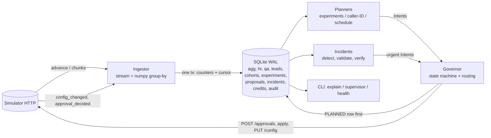

# Outcome-First Agent Loop — Submission

**Name:** [fill in] · **Date:** 2026-11-07 · **Hours actually spent (be honest):** [fill in] · **Language / storage:** Python 3.10 (numpy, httpx) / SQLite (WAL), no new dependencies

> Copy this file to `SUBMISSION.md`. Keep the headings. Be concrete: numbers, examples, diagrams. If a
> section doesn't apply, say why in a line rather than deleting it.

---

## 0. TL;DR
A single-process controller that ingests the event stream into durable counters, runs randomised welcome/voice tests with deterministic Bayesian decisions, rotates degraded caller IDs, tunes cohort call-time, and fixes hallucination incidents (revert to last-good prompt first, LLM only if needed) — every change via a crash-safe, audited governance state machine.
public_01: **+11.3%** conclusion rate vs baseline (pickup +6.3%, engagement +3.9%), 13 changes, **0 harmful**. public_02: **+24.4%**, hallucinated calls 416→200 (ks_cancel 330→111), 17 changes, **0 harmful**, 5 credits. public_03: **+17.8%**, 3 min 48 s end to end, 74 k events/s, 482 MB.
Survives SIGKILL x4 mid-run with approvals pending: no double apply, no lost proposal, one continuous audit trail (`reports/crash_recovery.md`).
Cut: per-person call-time, cross-axis cohorts, web UI, cross-tenant credit arbitration. Weak spot: statistical power at dev scale (17–42% of the engagement headroom captured).
Everything is queryable from our own SQLite: `python -m controller.cli explain --wf X --at "D3 14:00"`.

## 1. Assumptions
1. **Welcome message and voice act after pickup**, so they can move engagement but not pickup; only caller ID and *who is dialled when* (schedule) can move pickup. Pickup-primary workflows therefore get caller-ID and schedule work, not welcome/voice tests. Guardrail checks still measure the other KPI for every candidate.
2. **Guardrail `*_max_drop` is an absolute drop in the guardrail rate** (0.02 = two points), checked as P(drop within tolerance) ≥ 0.80.
3. **History carries no variant information**: the default config allocates one welcome message and one voice, so pre-D0 data gives baselines, hour profiles, caller-ID baselines and the hallucination base rate, never option priors.
4. A global hour-weight table is a no-op (it scales every eligible lead equally), so schedule tables only make sense per cohort.
5. Each dial's welcome/voice/caller-ID is sampled independently (per the contract), so marginal arm contrasts are unbiased even when the other dimensions vary. Contrasts are stratified by (config version × cohort) so allocation changes cannot confound them.
6. QA hallucination flags are noisy: baseline is estimated from the workflow's own pre-incident flag rate (false positives included), never assumed to be zero.
7. Validation measures safety only. Engagement after a prompt change is verified from production calls; a fix that hurts engagement is treated as a regression.
8. The approver is a black box with working hours and latency; decision time ≈ next_working(now + latency). Requests that cannot be decided inside their TTL are not sent (they would be guaranteed to expire).
9. Fatigue limit (`max_requests_per_24h`) counts every request, including rejected and expired ones; the controller keeps one slot per 24h in reserve for incidents.
10. A supervisor edit is legitimate and wins: the edited dimensions are put on a 48h hold, experiments are re-derived from the live config, in-flight proposals are left to go stale and are re-planned. The one exception is an incident fix, which is *proposed* (never forced) and explains the evidence.
11. Hidden scenarios share the public schema/ranges (≤20 cohorts, 15-minute ticks, same event types and start date). The date of D0 is read from `/sim/state`, never hard-coded.
12. Per-person call-time was not built; a person has too few calls for a defensible preferred-hour estimate in the scenario horizon.

## 2. Scope decisions
| # | Capability | Built / Partial / Cut | Why | What it would take to finish |
|---|---|---|---|---|
| C1 | Event ingestion | **Built** | Everything else depends on fresh, correct counters. Streaming NDJSON, numpy group-by, one transaction per chunk with the cursor, idempotent replay. | Partition by workflow across processes for 10×. |
| C2 | Shared cohort object | **Built** | One `cohorts` registry and one config representation used by experiments, schedule, audit and the supervisor view. Single partition axis per workflow, single-value cohorts, ids like `age_band=60+`. | Cross-axis cohorts (see §13). |
| C3 | History bootstrap | **Built (scoped)** | Baseline rates, hour profiles, caller-ID baselines and the hallucination base rate come from history. No option priors exist in history (assumption 3). | Decay-weighted priors once history contains real variation. |
| C4 | Call-time optimisation | **Partial** | Per-cohort hour weights from history, gated by significance and expected gain. Per-person cut. | Per-person preferred hour for returning persons with ≥3 connects. |
| C5 | Caller-ID health | **Built** | Concurrent sibling comparison + own-history drift, persisted bad set with floor share and re-probe, untested IDs probed at 8%. | Load-aware (dials/hour per ID) allocation. |
| C6 | Welcome/voice experiments | **Built** | Randomised multi-arm tests, Šidák over arms, minimum trials, futility pruning, harm stop, EB-shrunk slice effects with a Q heterogeneity gate. | Joint welcome×voice cells when traffic allows. |
| C7 | Promotion, decay, rollback | **Built** | 85/15 controlled promotion; winner vs. holdout over a 36h window; rollback + retirement. | Per-arm sequential tests (CUSUM) for faster decay detection. |
| C8 | Hallucination incident loop | **Built** | Detect → revert-to-last-good first (free) → LLM only if needed → validate → evidence-backed proposal → verify (flags and engagement). | Multi-incident credit arbitration. |
| C9 | Governance client | **Built** | Full state machine, deterministic ids, TTL/hours/fatigue-aware submission, batching, stale/lapse/reject handling, auto-apply rules. | — |
| C10 | Honest scores/dry runs | **Partial** | `affected_leads` from live lead table, dry runs replay recorded randomised arms, impact is a documented bounded formula. No cross-validation of the replay. | Hold-out replay on a past window. |
| C11 | Supervisor view | **Partial** | `python -m controller.cli supervisor` (one screen); no web UI. | Thin HTTP/JSON endpoint over the same query. |
| C12 | Audit store | **Built** | Every decision, evidence, route, approval transition, apply and follow-up is in SQLite; `explain` answers the "why" question. | Retention/partitioning. |
| C13 | Crash recovery | **Built** | Demonstrated with SIGKILLs (§9). | — |
| C14 | Observability | **Partial** | `metrics` table + `health` command; alert list is explicit (§10). No exporter. | Prometheus endpoint. |
| C15 | Fair credit/attention allocation | **Partial** | Credits are only spent on incidents with a reserve; approver attention is protected by per-workflow budgets and one slot reserved. No cross-tenant arbitration. | Weighted fair queue across tenants. |

**Principle:** build the loop end to end and make the parts that can hurt a client (governance, statistics, incident response, crash safety, audit) correct before adding breadth. Everything cut is a lever (per-person timing, cross-axis cohorts, UI) whose evidence base is too thin in the scenario horizon to defend.

## 3. Stakeholders
### 01 Sales — Nikhil Rao
- **Accepted:** speed where it is safe: rollbacks, harm stops and caller-ID rotations use the fast path; routine batching is minimal; the supervisor view gives a per-client lift table.
- **Declined:** a single blended score (violates the KPI definition and Product's memo); promoting a winner to everyone by evening (we promote 85/15 with a holdout and need evidence first); the "persuasive" prompt (it is the one that raises hallucination risk; prompts only change through an incident fix with validation).
- **Wrong against the contract:** "Kestrel has auto-apply for everything" — `ks_cancel` allows only schedule, caller_id, welcome_message, voice, capped at a 0.2 shift; prompts and cohorts are not allowed. "Northwind is fine with auto-apply on KYC" — `nw_kyc` has auto-apply **disabled**.
- **Reply:** *Nikhil — you'll get a lift figure per client per KPI (pickup, engagement, conclusion), not a blend; blending hides which lever moved. Winners go live at 85% with a 15% holdout so we can prove the lift and catch decay; I won't take it to 100% by evening. Kestrel's policy only auto-applies schedule, caller-ID, welcome and voice within a 0.2 shift, and Northwind KYC has auto-apply off, so those changes go through the approver. The "persuasive" prompt is out unless an incident fix validates it. For the summit I can show the audit trail of one real change end to end.*

### 02 Compliance — Meera Iyer (Northwind)
- **Accepted:** all customer-facing changes (welcome, voice, prompt, cohorts) go through a named approval on Northwind workflows (their policy permits auto only for schedule/caller_id, and we don't auto-apply customer-facing growth moves anywhere); prompt changes carry a validation run; every proposal has diff/dry-run/rationale; `explain` reconstructs variant-and-reason by config version.
- **Declined:** "no customer even briefly worse off" cannot be guaranteed by any experiment; we bound it (futility/harm stops, minimum evidence, control share ≥ 40%) and say so. A per-customer "what did they hear" answer needs the call events (`variant`, `config_version`) held by the platform; our store gives the version-level reason and the lookup key.
- **Wrong/clarify:** approvers work 10–19 (KYC 10–18); a request sent at night is *guaranteed* to expire on a 12h TTL, so we hold such requests until the window opens.
- **Reply:** *Meera — agreed on all five. Anything a customer hears (opening line, voice, script) is proposed to your named approver with the diff, dry run and, for scripts, a validation run; operational changes (timing, caller-ID rotation) are applied within policy and listed in the weekly summary. For an auditor's question we can show, per config version, the variant and the reason it was live; the per-call lookup uses the platform's call event, which carries that version. Experiments are bounded (the incumbent keeps ≥40%, harmful arms are stopped on evidence) but I can't promise zero exposure to a worse variant.*

### 03 Platform/SRE — Kabir Menon
- **Accepted:** kill/restart test (§9), idempotent writes with deterministic proposal ids, no new infrastructure (embedded SQLite file, one process), `health` command, explicit pageable-alert list (§10), 10× analysis (§8).
- **Declined:** reusing Postgres/Redis for now — a single-writer embedded store is enough at this scale and has no 2 a.m. operator; sharding by workflow is the migration path.
- **Wrong/clarify:** none factually wrong; the 10 min/day target is measured in §8.
- **Reply:** *Kabir — killed with SIGKILL four times mid-run (including with approvals pending); it resumed from a durable cursor, never double-applied and kept one continuous audit trail (reports/crash_recovery.md). State is one SQLite file (WAL) written transactionally; no Redis/Postgres needed at this scale, and the 10× plan is to shard workflows across processes with a DB each. `controller.cli health` shows ingest lag, decisions, credits and what is page-worthy; only stuck proposals, escalated incidents, ingest failure and credit exhaustion should page.*

### 04 Client ops supervisor — Anita Desai (Kestrel)
- **Accepted:** her edits are never undone (48h hold on edited dimensions; in-flight proposals go stale and are re-planned); one batched request per workflow, routine requests never before 11:00 and at most 2 a day; one-screen supervisor view; fixes are checked for engagement after rollout (the verbatim-script failure mode).
- **Declined:** "tell me *before* anything changes": changes that go through an approval are announced by the request itself; auto-applied changes are limited to protective moves (rollbacks, caller-ID health, incident fixes where permitted) and appear in the view and digest. We cannot block those without losing the fast path.
- **Wrong/clarify:** Kestrel's policy allows up to 4 requests/24h; her "2 a day, not before 11:00" is stricter and is adopted as our self-imposed routine limit, with incident fixes exempt.
- **Reply:** *Anita — your edits stay: if you change something we hold off that dimension for 48 hours and re-plan around it. You'll get one batched request at a time, never before 11:00, at most two routine requests a day; fixes for a bad prompt are the exception. `controller.cli supervisor` is the one screen: what's being tested, what's winning, what's waiting on you, what changed today. Prompt fixes are re-checked on engagement after rollout, so a safe-but-lifeless script gets flagged. One thing I can't promise: protective changes (rolling back a decayed winner, rotating a bad caller ID) may apply without a prior request.*

### 05 Product — Tara Kulkarni
- **Accepted:** pickup/engagement/conclusion never blended; one cohort object (`cohorts` table, same id in config, experiments, schedule, audit and view); minimum sizes with the cost stated (§5); proposals carry impact/diff/affected/dry-run with a documented formula; only observed exposure counts (evidence = recorded calls by variant and version); a winner changes that workflow only.
- **Declined:** per-person call-time as P0 (cut, assumption 12); treating an expired proposal as a bare rejection — we do treat it as a non-decision, wait for a cooldown and re-propose with *fresh* data and a new id, never the stale body.
- **Wrong/clarify:** "ranking the queue by impact" works only if the score is comparable across workflows; ours is bounded and based on expected lift × population × confidence.
- **Reply:** *Tara — held to all your definitions: pickup, engagement and conclusion are separate everywhere; one cohort object with one id across detection, experiments, schedule and the supervisor view; only calls that actually ran count as evidence. Minimum cohort size is 8% of traffic and ≥200 trials per arm-slice, which costs days of speed to avoid false winners. Impact score = 1−exp(−(expected relative lift × share affected × confidence)/0.03), so it ranks. Per-person call-time and a web UI are cut; caller-ID health and the supervisor CLI are in.*

### 06 CTO — Aryamann
- **Accepted:** choose and say no; spend credits only where they change a decision (5 credits in public_02: one validation, no LLM call because the last-good prompt validated); trust the contract over memos; documentation for the on-call.
- **Declined:** nothing to decline; this memo is a rubric.
- **Reply:** *Aryamann — understood. Cut: per-person timing, cross-axis cohorts, UI, cross-tenant arbitration. Built end to end: ingest, shared cohorts, experiments with decay/rollback, caller-ID health, incident loop, governance, audit, crash recovery. Public_02 spent 5 credits: the last-good prompt was free to propose and needed one validation. What breaks first at 10× is the single-process aggregation of one workflow's chunks; the plan is per-workflow sharding.*

## 4. Architecture

- **State** lives only in SQLite: additive counters keyed by (workflow, 6h block, config version, cohort, lever, option, one-feature slice); experiment memory; cohort registry; proposals; incidents; credit ledger; audit; metrics.
- **Planners are stateless functions** of counters + live config + small experiment memory; they emit `Intent`s (declarative patches). The governor merges intents into **one** proposal built from the *current* config, so unrelated edits (a supervisor's) are never overwritten.
- **Restart:** reopen DB → read `/sim/state` → ingest from the durable cursor → refresh configs (records supervisor edits) → `governor.reconcile` adopts or resends `PLANNED` proposals by deterministic id, polls `PENDING`, applies `APPROVED` → continue. The simulator is never re-advanced blindly: after an ambiguous `advance` failure the state is re-read.
- **Ingest:** each chunk is streamed, reduced to integer columns, grouped with `np.unique`/`bincount` into ~20 marginal tables per batch and upserted additively; cursor and counters commit atomically, event ids ≤ the stored last id are skipped. Lead→feature joins use a bounded in-memory map (evicted after the cadence window, rebuilt from SQLite).

## 5. The learning loop
- **Cohorts.** One shared registry/ID scheme (`age_band=60+`). A workflow has a single *partition axis* (one lead feature) chosen from evidence, cohorts are single values of that axis, so they are disjoint (first-match order is irrelevant) and every lever's allocation/schedule per cohort is well defined. A cohort needs ≥8% of traffic, ≥200 trials per arm-slice, ≥0.4pt expected gain, and the effect must differ across the axis (Cochran Q, Bonferroni over features × options). At most 6 cohorts; `default` always remains. *Cost:* the single axis cannot exploit "voice by age" and "welcome by language" at once.
- **Experiment design.** Welcome and voice are explored **simultaneously** (the simulator samples dimensions independently, so each marginal is a clean randomised contrast and one stream of calls serves both tests). Incumbent keeps ≥40% (≥70% if a supervisor chose it); challengers split the rest equally. A joint factorial was rejected: 3×4 = 12 cells would need ~3× the traffic; interactions are *monitored* (decay/harm checks use the realised mix) rather than modelled. Exploration is skipped if the expected trials per arm over the remaining horizon cannot reach the minimum (cost > benefit).
- **Deciding a winner.** Beta-Binomial posteriors (prior = workflow's own history rate, strength 4), normal approximation to the posterior difference; contrasts are computed per (config version × cohort) stratum and pooled by inverse variance, so allocation changes never create Simpson-type artefacts. Promote arm *a* only if: ≥250 KPI trials in both arms; P(lift > 3% relative) ≥ 1−Šidák(0.07, #challengers); guardrail P(drop within tolerance) ≥ 0.80; the arm is not retired. Harmful (P(worse by 2% relative) ≥ 0.95) arms are stopped immediately; arms with P(better than control) ≤ 0.10 are pruned to concentrate traffic. Slice effects use empirical-Bayes partial pooling (DerSimonian–Laird τ²) and need a Bonferroni-raised bar; options already judged harmful/futile are never re-offered. Everything is closed-form and deterministic.
- **False-winner rate** (Monte Carlo of the shipped rule, `scripts/false_winner_sim.py`, 8 sequential looks):

| scenario | P(promote some arm) | mean connected calls per arm at promotion |
|---|---|---|
| all arms identical, 1 challenger | 6.5% | 503 |
| all arms identical, 3 challengers | 4.8% | 434 |
| one challenger +6% relative | 45.2% | 614 |
| one challenger +10% relative | 81.2% | 550 |
| one challenger +10% of 3 | 61.2% | 661 |

  The price of safety is visible: with 3 challengers a real +10% lift is found 61% of the time within the 8 looks. Peeking is covered by the 3% practical threshold plus the alpha level, not by a formal spending function (see §13).
- **Promotion and decay.** Winners go to 85% with a 15% control holdout. Each evaluation compares winner vs holdout over a rolling 36h window (≥100 trials per arm); if P(still ≥ half the promoted lift) ≤ 0.20 (or the whole-period contrast turns credibly harmful) the winner is rolled back, retired for 3 days and the lever re-explored without dropped options. In public_01/02 the decaying W3 fell from 85% of in-population calls to 0% within 1–2 days of onset (§11).
- **Call time and caller ID.** *Schedule:* a global hour table is a no-op, so tables are per axis-cohort, from pre-change history only (no feedback from our own reweighting): hour affinity r = (p_vh/p_v)/(p_h/p) with |ln r|·√conn ≥ 3, weights clipped to [0.35, 3], listed for **every** window hour (omitted hours get weight 0 per the contract), applied only if the replayed expected pickup gain ≥1.5%. *Caller ID:* concurrent siblings are randomised per dial, so each ID is tested against its siblings (one-sided z, Bonferroni, ≥15% relative drop, ≥200 dials in 36h) and against its own previous window; a flagged ID is kept at a 3% floor (a persisted bad set stops it being mistaken for "untested"), untested IDs are probed at 8%, recovery needs ≥300 floor-share dials back within 10% of siblings. Spreading volume across healthy IDs is itself the default move.
- **Guardrail.** Every candidate is also contrasted on the other KPI; a lift that fails the guardrail is reported `guardrail_blocked` in the audit rather than promoted. For pickup-primary workflows welcome/voice are not tested (assumption 1).

## 6. Governance
```
PLANNED --send--> PENDING --approved--> APPROVED --apply--> APPLIED
   |                 |  \--rejected--> REJECTED        \--410--> LAPSED
   |                 \---expired----> EXPIRED          \--409 stale--> STALE
   \--auto route (PUT /config, only if policy permits)--> APPLIED | REFUSED(403) | STALE
Terminal states (REJECTED/EXPIRED/LAPSED/STALE/REFUSED) are re-planned from fresh evidence and the *current* base version, under a new id (`-rN`).
```
- **Idempotency:** `pid = <wf>-v<base>-<sha1(proposed config)[:12]>[-rN]`, persisted as `PLANNED` before the request; reconcile finds a landed request via `GET /approvals` (or config history for auto) and adopts it. One in-flight proposal per workflow.
- **Timing:** routine requests only after 11:00 and ≤2/day (Kestrel's ask, stricter than policy); worst-case decision time `next_working(now + max_latency)` must fall inside the TTL (otherwise the request is *guaranteed* to expire, so it is deferred until the approver window opens); one of the `max_requests_per_24h` slots is reserved for incidents; rollbacks/harm stops/incident fixes are urgent. While anything is pending the loop polls every 15 simulated minutes so the 2h apply window is never missed; otherwise hourly.
- **Rejected/expired:** cooldown of 6h, ≤3 attempts per identical change, then new evidence-based proposal under a new id. **Stale:** audited with the intervening actor, never forced.
- **Auto-apply vs. approval:** auto only if policy enabled ∧ every changed dim allowed ∧ TV shift ≤ `max_shift` ∧ (operational dim ∨ protective move). Customer-facing growth moves (welcome, voice, cohorts, prompt) go to a human even where policy would allow auto (Compliance and Kestrel asked to be told first); protective moves (harm stop, decay rollback, caller-ID health, incident fix when permitted) use the fast path.
- **Honesty of proposal fields:** *affected_leads* = live leads (within the cadence window) in the changed scopes; *dry_run* = replay of the recorded randomised arms (expected KPI old vs new with a 95% interval; per-ID pickup for caller IDs; the validation run for prompts); *impact_score* = `1 − exp(−(expected relative lift × share affected × confidence)/0.03)` ∈ [0,1], incident fixes ≥0.9. The replay reuses the same data that produced the decision, so it is a consistency check, not an out-of-sample estimate.
- **Supervisor edits:** `config_changed` with `actor=supervisor` is recorded, edited dimensions are held for 48h (the loop will not touch them), a running experiment whose allocation no longer matches is reset, in-flight proposals are left to go stale and are re-planned; a supervisor-chosen incumbent is challenged with ≤30% traffic afterwards. Prompt edits are not held (the incident loop must be able to react) but are only ever *proposed*.

## 7. Incidents
- **Detection:** per-prompt flag rate of connected calls since the version that introduced the prompt vs. the workflow's own pre-change flag rate b0 (false positives included). Open when n ≥ 150, ≥5 flags, P(X ≥ k | p₀ = 1.25·b0 + 0.001) < 0.003 **and** rate ≥ 2·b0, on two looks ≥45 min apart. A single flagged call can never open an incident; a rate at baseline cannot (tested). Under the null each look opens with probability ≤0.3% (the p-threshold) before the 2×-baseline and two-look conditions, which cut it further (not separately measured).
- **Choosing the fix:** (1) prompts that ran in this workflow before with a flag rate within baseline (the supervisor's previous prompt) cost nothing to nominate; (2) each candidate gets one validation run (n=500, 5 credits); (3) only if none passes does it call the LLM (3 credits, ≤2 rounds per incident), validating ≤3 suggestions and also validating the current prompt once as a same-scale reference — an untried prompt must beat it with z ≥ 1.64 and clear `min_validation_pass_rate`; (4) otherwise the incident is escalated (page). Validation says nothing about engagement, so after the fix lands we check the flag rate (resolve when ≤ max(½·incident rate, 1.5·b0+0.003) on ≥200 calls) **and** engagement against the pre-incident prompts (reopen if credibly >7% lower), which is the verbatim-script failure mode from Anita's memo.
- **Credits:** only incidents spend; a reserve of 60 is kept; every spend is a ledger row with its purpose. public_02 spent **5 of 200**.
- **public_02 timeline (ks_cancel, from the audit store):**

| sim time | event |
|---|---|
| D2 10:00 | (sim) a caller ID is flagged; D2 13:45 the controller proposes the reroute together with a decay rollback; applied 16:00 → flagged ID's share 29.7% on D2 → 2.9% from D3 |
| D3 11:30 | supervisor ships prompt P2 (hallucination-prone) → controller records `supervisor_edit`, holds nothing on the prompt |
| D3 20:45 | incident opened: 33/860 = 3.8% flagged vs 1.4% baseline (p = 1.3·10⁻⁴); candidate P1 (last-good, ran in production) validated 0.986 on n=500, 5 credits, **no LLM call** |
| D3 22:15 | fix proposed (the earliest instant its worst-case decision time still fits the 12h TTL; at 20:45 it would have expired overnight) |
| D4 10:00–10:15 | approver decides; applied → **MTTR 1365 min** |
| D4 13:15 | verified: 6/315 = 1.9% flagged → incident resolved |

  Honest reading: 9h15m of the MTTR is statistical detection time; the rest is the approver being offline overnight (policy forbids auto-applying a prompt). Hallucinated calls in ks_cancel fell from 330 (baseline) to 111.

## 8. Scale
Measured on public_03_load (`reports/load_test.md`): whole run (7 history days + 5 live days, 12 workflows, 9.74 M events) in **3 min 48 s** with the simulator on the same box (≈46 s per live simulated day vs. the 10-minute budget); **74 k events/s** live ingest (62 k/s bootstrap); decision lag per step mean 0.26 s / p95 0.85 s / max 3.7 s; peak RSS **482 MB**; DB 95 MB; 0 HTTP errors; 0 harmful changes. Methodology and reproduction are in `reports/load_test.md`.
What breaks first at 10×: the in-memory lead→feature map (~4–5 GB), then unbounded `agg` growth (roll up old 6h blocks), then single-process planner time for hundreds of workflows. Partition by workflow (each worker owns a DB, lead map and its evaluation schedule); tenants then fan out naturally. Raw ingest is not the limit: production at 10× is ~100–200 events/s.

## 9. Reliability
- **Method:** `scripts/crash_demo.py`: serve public_02, run the controller, SIGKILL it at random wall-clock moments (4 kills), restart each time against the same DB, then verify against the simulator that no proposal id was submitted twice, no approval/proposal produced two config versions, every locally `APPLIED` proposal exists in the simulator and vice versa, and the scenario finished.
- **Result (`reports/crash_recovery.md`):**

scenario `02_incidents`, SIGKILL x4, seed 7

- kill 1: sim 2027-01-05T10:15:00+05:30, event cursor=38, open proposals at kill=[]
- kill 2: sim 2027-01-06T07:15:00+05:30, event cursor=79, open proposals at kill=[('nw_kyc-v1-6f8e2a50b05a', 'PENDING'), ('nw_renewal-v3-fb2200a88641', 'PENDING')]
- kill 3: sim 2027-01-07T22:30:00+05:30, event cursor=148, open proposals at kill=[('nw_kyc-v3-4059785c3fb9', 'PENDING'), ('nw_renewal-v5-bb96b941a35a', 'PENDING')]
- kill 4: sim 2027-01-09T11:15:00+05:30, event cursor=169, open proposals at kill=[]
- final run exit code 0

- controller starts recorded in audit: 5 (4 restarts)
- approvals in simulator: 16, unique proposal ids: 16
- proposals by local state: {'APPLIED': 14, 'REJECTED': 2, 'STALE': 1}
- audit rows: 101 (continuous across restarts)
- scenario finished: True
- **violations: none**

- **State lost on crash:** none that matters — at worst the current chunk is re-streamed (transactional), and credits charged by the simulator but not yet recorded (a validation result between charge and commit; documented in the runbook).
- **Idempotency keys:** ingest cursor + `event_id`; proposal id = hash of (workflow, base version, config); incident ids = (workflow, prompt, version); config version snapshots keyed (workflow, version); follow-ups keyed by proposal id.
- **HTTP behaviour:** reads retry with bounded exponential backoff on connection errors/5xx; side-effecting calls are never blindly retried: `advance` re-reads state, `POST /approvals` and `PUT /config` are reconciled by deterministic id (409 `duplicate_proposal_id` ⇒ adopt), `apply` 409 `not_approved` ⇒ re-read the approval, 409 `stale_base_version` ⇒ terminal `STALE` and re-plan, 410 ⇒ `LAPSED`, 403 ⇒ `REFUSED` (never retried), 402 ⇒ validation skipped and escalated, 409 `finished` ⇒ clean exit; malformed lines are counted and skipped.

## 10. Audit & observability
"Why did ks_cancel change on D4, who approved it, what happened next?" — answered from our store only:

```
$ python -m controller.cli --db controller_state.db explain --wf ks_cancel --at "D4 14:00"
[ks_cancel] config v7 went live at 2027-01-08 10:15 (D4) (route: approval; dims: prompt_version)
  WHY    : Replace prompt P2 with P1 (hallucination flag rate 3.8% vs 1.4% baseline)
           Incident inc:ks_cancel:P2:v5: 33/860 connected calls flagged on P2. P1 validated at pass_rate 0.986 (n=500, policy floor 0.97); it ran in production before with a flag rate within baseline. Validation measures safety only; engagement is verified aft
  SCOPE  : affected_leads=7500  impact_score=1.0  base_version=6
  DRY RUN: {"prompt_fix": {"method": "validation run (synthetic conversations, safety only)", "n": 500, "pass_rate": 0.986, "current_prompt_production_flag_rate": 0.0384, "engagement_effect": "not measured by validation; verified post-apply"}}
  TIMELINE (from controller audit):
    2027-01-07 22:15 (D3)  proposal_planned     [controller] Replace prompt P2 with P1 (hallucination flag rate 3.8% vs 1.4% baseline)
    2027-01-07 22:15 (D3)  proposal_submitted   [controller] approval apr_00013 requested; expires 2027-01-08T10:15:00+05:30
    2027-01-08 10:15 (D4)  proposal_approved    [client_approver] approved by client approver at 2027-01-08T10:00:00+05:30; apply by 2027-01-08T12:00:00+05:30
    2027-01-08 10:15 (D4)  proposal_applied     [controller] config v7 live
    2027-01-08 10:15 (D4)  incident_fix_applied [controller] prompt P1 live at v7; verifying
    2027-01-09 10:15 (D5)  followup             [controller] 24h after apply: engagement_rate pre 0.4318 -> post 0.5082 (descriptive; not causal)
  EVIDENCE inc:ks_cancel:P2:v5:fix:P1: {"incident": "inc:ks_cancel:P2:v5", "detection": {"prompt": "P2", "since_version": 5, "flagged": 33, "connected": 860, "rate": 0.0384, "baseline_rate": 0.0142, "baseline_n": 20006, "h0_rate": 0.0188, "p_value": 0.00013404
  WHAT HAPPENED NEXT:
    2027-01-08 13:15 (D4)  incident_resolved  flag rate 6/315=1.9% after fix (was 3.8%); incident closed
    2027-01-08 14:15 (D4)  followup           24h after apply: engagement_rate pre 0.4932 -> post 0.435 (descriptive; not causal)
    2027-01-09 10:15 (D5)  followup           24h after apply: engagement_rate pre 0.4318 -> post 0.5082 (descriptive; not causal)
    2027-01-09 16:15 (D5)  proposal_applied   config v8 live
```
Other views: `supervisor` (one screen: testing / winning / waiting on you / changed today), `proposal <id>` (full body), `log`, and `health`:

```
=== Controller health @ 2027-01-14 00:00 (D10) ===
  ingest_events_per_sec    last=19412.357972909154  avg=19395.881  max=116119.801  samples=265
  decision_lag_seconds     last=0.022293326001090463  avg=0.036  max=2.053  samples=544
  credits_remaining        last=195.0  avg=196.912  max=200.0  samples=544
  open_proposals           last=0.0  avg=1.059  max=3.0  samples=544
  open_incidents           last=0.0  avg=0.105  max=1.0  samples=544
  sim_http_errors          last=0.0  avg=0.0  max=0.0  samples=544
  proposals by state: {'APPLIED': 17, 'REJECTED': 3, 'STALE': 1}
  decisions/day: {0: 4, 1: 4, 2: 3, 3: 3, 4: 1, 5: 3, 6: 1, 7: 2}
  credits spent: 5.0
  db pages: 3700 KiB
  PAGE-WORTHY NOW: none
```
**Page on:** a proposal stuck `PLANNED` > 2h (simulator unreachable/refusing), `incident_escalated` (needs a human), `credit_skip` (reserve exhausted mid-incident), ingest not advancing > 30 min wall time, process down. **Do not page on:** rejections/expirations (re-planned), `deferred` (waiting for approver hours), supervisor edits, single HTTP failures (retried), decay rollbacks. Debug-only metrics: ingest events/s, decision lag, open proposals, credit balance, HTTP error count.

## 11. Results
Baselines: no-op controller on the same scenario (`python -m sim baseline`). Full reports: `reports/public_01.md`, `reports/public_02.md`, `reports/public_03.md`.

**public_01** (13 changes: 8 beneficial, 5 neutral, **0 harmful**; 11 approvals, 2 judgement-call rejections, 2 auto-applies, 0 conflicts, 0 credits)

| workflow | conclusion rate | Δ | pickup | Δ | engagement | Δ | engagement gap captured | hallucinated calls (base) |
|---|---|---|---|---|---|---|---|---|
| ks_cancel | 0.359 | +7.7% | 0.244 | +2.3% | 0.512 | +4.3% | 17% | 61 (47) |
| nw_kyc | 0.444 | +22.2% | 0.288 | +19.1% | 0.597 | +1.0% | 0% | 34 (21) |
| nw_renewal | 0.458 | +9.2% | 0.275 | +4.5% | 0.570 | +4.4% | 30% | 47 (42) |
| ALL | 0.410 | +11.3% | 0.263 | +6.3% | 0.551 | +3.9% | 17% | 142 (110) |

**public_02** (17 changes: 14 beneficial, 3 neutral, **0 harmful**; 17 approved, 3 rejected, 1 apply conflict from a supervisor edit — handled; 5 credits)

| workflow | conclusion rate | Δ | pickup | Δ | engagement | Δ | engagement gap captured | hallucinated calls (base) |
|---|---|---|---|---|---|---|---|---|
| ks_cancel | 0.339 | +36.9% | 0.232 | +26.0% | 0.506 | +6.2% | 42% | 111 (330) |
| nw_kyc | 0.476 | +27.1% | 0.298 | +23.0% | 0.604 | +2.0% | 0% | 33 (31) |
| nw_renewal | 0.482 | +13.1% | 0.284 | +8.6% | 0.565 | +3.2% | 30% | 56 (55) |
| ALL | 0.416 | +24.4% | 0.263 | +18.3% | 0.550 | +3.7% | 33% | 200 (416) |

Interpretation. The largest wins are *pickup* wins from caller-ID health and spreading volume (nw_kyc +19–23% pickup, a pickup-primary workflow with auto-apply off, so these went through the approver) and incident handling in public_02. Engagement gains are real but partial (+3–6%, 17–42% of the hidden headroom): at 300–400 dials/hour there are ~1 000 connected calls a day, so a 4-arm test needs 3–6 days for a 10% lift, and subgroup effects (e.g. one voice for one age band) cannot reach the Q-test bar inside 8 days. The first versions of the controller were **harmful** twice for reasons found in the grader output and fixed in general rules (not per-scenario): (1) a cohort was cut on `value_band` from one day of data (→ heterogeneity gate + Bonferroni bar); (2) a rollback re-explored an option already judged harmful, and a restart explored away from a supervisor's incumbent with 60% traffic (→ dropped-option memory, gentler challenge of human incumbents). Remaining neutral changes are mostly exploration starts, which by design cost nothing in expectation.

## 12. Trade-offs & rejected alternatives
| Option | Why considered | Why rejected / what instead |
|---|---|---|
| Thompson sampling / bandit | Faster than fixed allocation | Every allocation change is a governed request with approver latency; per-dial adaptivity is impossible, and decisions must be deterministic. Used successive pruning at approval cadence instead. |
| Frequentist z-tests with Holm | Standard | Needs a fixed horizon; posterior probability of *practical* lift (>3%) and Šidák over arms gave one consistent rule for winner, harm and futility. |
| Full factorial welcome×voice | Interactions | 12 cells ≈ 3× traffic; marginals are unbiased under independent sampling; interactions are monitored through decay/harm checks. |
| Multi-feature / per-lever cohorts | Capture "voice by age, welcome by language" | Overlapping first-match cohorts confound evidence and fragment traffic; single disjoint axis chosen instead (cost in §13). |
| Postgres/Redis | Already operated | SQLite WAL meets the 8 GB/4 vCPU box, needs no 2 a.m. operator, gives transactional cursor+counters; shard-per-worker is the scale path. |
| Per-event rows in DB | Simple, replayable | 850 k events/day × retention; additive aggregates keep memory/DB bounded and make replay idempotent. |
| LLM-first incident fixes | Matches the brief | The previous prompt is free, has production history and needs one validation; the LLM is only used when that fails. |
| Auto-apply wherever policy allows | Speed (Sales) | Customer-facing growth moves go to a human; only protective/operational moves use the fast path. |
| Per-person call-time | Product's headline | A person has 1–3 connected calls in the horizon; a preferred-hour estimate would be noise dressed as a feature. |

## 13. Known weaknesses
1. **Power at small scale.** Engagement headroom captured is 17–42%; subgroup effects need more traffic than 8 days provide. Hidden dev-scale scenarios will see the same ceiling.
2. **Sequential testing is guarded by thresholds, not a spending function.** Measured false-promotion rate ≈5–7% over 8 looks; a longer horizon with more looks inflates it.
3. **One partition axis per workflow**; cross-axis structure and welcome×voice interactions are not modelled.
4. **Decay detection latency** is ~1–2 days (15% holdout, 36h window); a false rollback costs one re-exploration, a late one costs lift. A CUSUM would be faster.
5. **Thresholds were tuned while looking at the public grader** (alpha level, Bonferroni bar, gentler incumbents). The rules are generic, but the numbers have seen the public scenarios; hidden ones may want different values.
6. **Incident MTTR is dominated by detection sample size and approver hours**; no way to shorten the latter under the policy.
7. **Schedule is one-shot** from pre-change history and no hold-out check; its measured effect in public runs is within noise ("neutral").
8. **The dry run replays the data that produced the decision** (not out-of-sample); `followup` numbers are descriptive, not causal.
9. **Credit loss window** between simulator charge and local commit; no cross-tenant credit/attention arbitration.
10. `mid_flight: next_campaign_only` is handled implicitly via version strata and not separately tested; the guardrail is read as an absolute drop (assumption 2).
11. No exporter/UI: observability is SQL + CLI.

## 14. If this went to production at Formi next month
1. **Days 1–2:** shadow mode — run the loop with the governor in dry-run (planned proposals written to audit, nothing sent) against a copy of live events for 2–3 workflows; compare its decisions with what the humans did. Confirm assumption 1 (welcome/voice cannot move pickup) and the guardrail unit with the product owner.
2. **Days 3–4:** move state to Postgres behind the same `Store` interface (we already run it); add a Prometheus endpoint for the §10 metrics and wire the four page-worthy alerts; run the kill/restart test in the deploy pipeline (21:30 deploys).
3. **Week 1:** enable caller-ID health and incident detection only (operational and protective), with approver notification in the weekly summary Compliance asked for; calibrate the incident null rate on real QA flags per tenant.
4. **Week 2:** enable welcome/voice experiments on two low-risk workflows with human approvers named; add the call-event lookup that answers Compliance's "what did this customer hear" within 24h; shard workflows across workers; run a replay backtest of the decision rule on three months of history to re-set thresholds out-of-sample and add a proper alpha-spending rule.
5. **Then:** per-person timing once enough returning-person history exists; CUSUM decay detection; cross-tenant credit and attention budgets.
