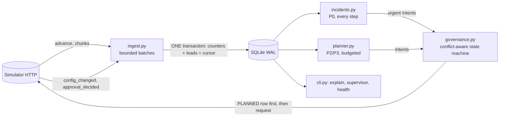

# Outcome-First Agent Loop — Submission

**Name:** [fill in] · **Date:** 2026-11-07 · **Hours actually spent (be honest):** [fill in] · **Language / storage:** Python 3.10 (numpy, httpx) / SQLite (WAL), no new dependencies

> Copy this file to `SUBMISSION.md`. Keep the headings. Be concrete: numbers, examples, diagrams. If a
> section doesn't apply, say why in a line rather than deleting it.

---

## 0. TL;DR
A single-process controller. It keeps per-arm counters from the event stream in SQLite (one transaction per chunk, memory bounded by a batch), runs randomised welcome/voice tests with one deterministic Bayesian rule plus a confirmation step on fresh data, reroutes degraded caller IDs, answers hallucination incidents (previous prompt first, LLM only if needed), and sends every change through an explicit proposal state machine with deterministic ids.
public_01 +8.0% conclusion rate vs baseline (12 changes, 0 harmful); public_02 +22.1% (16 changes, 0 harmful, hallucinated calls 416→184, 5 credits, incident MTTR 240 min); public_03 +16.2% in 3 min 24 s, 346 MB peak (40 changes, 0 harmful).
Four SIGKILLs mid-run: no duplicate, no lost proposal, one continuous audit trail. Decision path p99 0.13 s; ingest 73k events/s.
Not built: call-time optimisation, cross-axis cohorts, UI, cross-tenant credit arbitration.
Weakest points: little statistical power at dev scale (9–33% of the engagement headroom) and slow decay detection on small workflows.

## 1. Assumptions
1. **Welcome message and voice act after pickup**, so they can move engagement but not pickup; only caller ID and *who is dialled when* can move pickup. Pickup-primary workflows therefore get caller-ID work, not welcome/voice tests (I did not build call-time work, §2). Guardrail checks still measure the other KPI for every candidate.
2. **Guardrail `*_max_drop` is an absolute drop in the guardrail rate** (0.02 = two points), checked as P(drop within tolerance) ≥ 0.80.
3. **History carries no variant information**: the default config allocates one welcome message and one voice, so pre-D0 data gives baselines, hour profiles, caller-ID baselines and the hallucination base rate, never option priors.
4. A global hour-weight table is a no-op (it scales every eligible lead equally); only a table that differs between groups changes who is dialled when. I did not build call-time optimisation (§2).
5. Each dial's welcome/voice/caller-ID is sampled independently (per the contract), so marginal arm contrasts are unbiased even when the other dimensions vary. Contrasts are stratified by (config version × cohort) so allocation changes cannot confound them.
6. QA hallucination flags are noisy: baseline is estimated from the workflow's own pre-incident flag rate (false positives included), never assumed to be zero.
7. Validation measures safety only. Engagement after a prompt change is verified from production calls; a fix that hurts engagement is treated as a regression.
8. The approver is a black box with working hours and latency; decision time ≈ next_working(now + latency). Requests that cannot be decided inside their TTL are not sent (they would be guaranteed to expire).
9. Fatigue limit (`max_requests_per_24h`) counts every request, including rejected and expired ones; the controller keeps one slot per 24h in reserve for incidents.
10. A supervisor edit is legitimate and wins: the edited dimensions are put on a 48h hold, experiments are re-derived from the live config, a pending proposal built on an older version is abandoned and re-planned. The one exception is an incident fix, which is *proposed* (never forced) and explains the evidence.
11. Hidden scenarios share the public schema/ranges (≤20 cohorts, 15-minute ticks, same event types and start date). The date of D0 is read from `/sim/state`, never hard-coded.
12. Call-time optimisation (per cohort or per person) was not built. A person has 1–3 connected calls in the horizon, and cohort-level tables only help if hour preference correlates with the lead features, which I could not check from the API.

## 2. Scope decisions
| # | Capability | Status | Why | What finishing it would take |
|---|---|---|---|---|
| C1 | Event ingestion | Built | Streamed NDJSON, one transaction per chunk covering counters, leads and cursor; replay is a no-op; memory bounded by one 60k-event batch; bounded work per loop iteration. | Per-workflow sharding for 100×. |
| C2 | Shared cohort object | Partial | One `cohorts` table and one id scheme (`age_band=60+`) used by experiments, config, audit and the supervisor view. One partition axis per workflow, single-value cohorts only. | Cross-axis cohorts. |
| C3 | History bootstrap | Partial | History gives the KPI baselines, caller-ID baselines and the hallucination base rate. It has no variant information (the default config has one welcome and one voice), so there are no option priors. | Nothing to add until history contains variation. |
| C4 | Call-time optimisation | Not implemented | Removed in review. A global table is a no-op, a per-cohort table depends on hour preference correlating with lead features (unverifiable here), and its measured effect in the public runs was within noise. | Per-person preferred hour, evaluated against a hold-out. |
| C5 | Caller-ID health | Built | Pickup compared between concurrent, randomly assigned caller IDs; flagged ID kept at a floor; untested IDs probed. | Load-aware allocation. |
| C6 | Welcome/voice experiments | Built | Randomised arms, one decision rule (§5). | Interaction model. |
| C7 | Promotion, decay, rollback | Built | 85/15 promotion; rollback when the winner stops clearing the bar against its holdout. Detection is power-limited on small workflows (§13). | A sequential change detector. |
| C8 | Hallucination incidents | Built | Detect, previous prompt first, LLM only if needed, validate, propose with evidence, verify flags and engagement. | — |
| C9 | Governance client | Built | Explicit state machine, deterministic ids, TTL/hours/fatigue-aware submission, stale/abandoned handling. | — |
| C10 | Honest scores/dry runs | Partial | Formulas and fields are real, but the dry run replays the same data that produced the decision. | Replay on a held-out window. |
| C11 | Supervisor view | Partial | CLI (`supervisor`), no web UI. | A JSON endpoint over the same query. |
| C12 | Audit store | Built | Decisions, evidence, route, approval transitions, apply and follow-up are rows; `explain` reconstructs them. | Retention policy. |
| C13 | Crash recovery | Built | Demonstrated with SIGKILL (§9). | — |
| C14 | Observability | Partial | `metrics` table, `health` command, explicit page/no-page list (§10). No exporter. | Prometheus endpoint. |
| C15 | Fair credit/attention allocation | Not implemented | Only incidents spend credits (capped per incident), and the per-workflow request slots protect approvers. There is no cross-tenant arbitration. | A weighted queue across tenants. |

I built the loop end to end and spent the effort on the parts that can hurt a client: governance, the decision rule, incident handling, crash safety, audit. I cut the levers whose evidence I could not defend.

## 3. Stakeholders
### 01 Sales — Nikhil Rao
- **Accepted:** speed where it is safe: rollbacks, harm stops and caller-ID rotations use the fast path; routine batching is minimal; the supervisor view gives a per-client lift table.
- **Declined:** a single blended score (violates the KPI definition and Product's memo); promoting a winner to everyone by evening (we promote 85/15 with a holdout and need evidence first); the "persuasive" prompt (it is the one that raises hallucination risk; prompts only change through an incident fix with validation).
- **Wrong against the contract:** "Kestrel has auto-apply for everything" — `ks_cancel` allows only schedule, caller_id, welcome_message, voice, capped at a 0.2 shift; prompts and cohorts are not allowed. "Northwind is fine with auto-apply on KYC" — `nw_kyc` has auto-apply **disabled**.
- **Reply:** *Nikhil — you'll get a lift figure per client per KPI (pickup, engagement, conclusion), not a blend; blending hides which lever moved. Winners get a provisional half of the traffic, are confirmed on fresh data, and then run at 85% with a 15% holdout so we can prove the lift and catch decay; I won't take it to 100% by evening. Kestrel's policy only auto-applies schedule, caller-ID, welcome and voice within a 0.2 shift, and Northwind KYC has auto-apply off, so those changes go through the approver. The "persuasive" prompt is out unless an incident fix validates it. For the summit I can show the audit trail of one real change end to end.*

### 02 Compliance — Meera Iyer (Northwind)
- **Accepted:** all customer-facing changes (welcome, voice, prompt, cohorts) go through a named approval on Northwind workflows (their policy permits auto only for schedule/caller_id, and we don't auto-apply customer-facing growth moves anywhere); prompt changes carry a validation run; every proposal has diff/dry-run/rationale; `explain` reconstructs variant-and-reason by config version.
- **Declined:** "no customer even briefly worse off" cannot be guaranteed by any experiment; we bound it (harm stops, minimum evidence, control share ≥ 40%) and say so. A per-customer "what did they hear" answer needs the call events (`variant`, `config_version`) held by the platform; our store gives the version-level reason and the lookup key.
- **Wrong/clarify:** approvers work 10–19 (KYC 10–18); a request sent at night is *guaranteed* to expire on a 12h TTL, so we hold such requests until the window opens.
- **Reply:** *Meera — agreed on all five. Anything a customer hears (opening line, voice, script) is proposed to your named approver with the diff, dry run and, for scripts, a validation run; operational changes (timing, caller-ID rotation) are applied within policy and listed in the weekly summary. For an auditor's question we can show, per config version, the variant and the reason it was live; the per-call lookup uses the platform's call event, which carries that version. Experiments are bounded (the incumbent keeps ≥40%, harmful arms are stopped on evidence) but I can't promise zero exposure to a worse variant.*

### 03 Platform/SRE — Kabir Menon
- **Accepted:** kill/restart test (§9), idempotent writes with deterministic proposal ids, no new infrastructure (embedded SQLite file, one process), `health` command, explicit pageable-alert list (§10), 10× analysis (§8).
- **Declined:** reusing Postgres/Redis for now — a single-writer embedded store is enough at this scale and has no 2 a.m. operator; sharding by workflow is the migration path.
- **Wrong/clarify:** none factually wrong; the 10 min/day target is measured in §8.
- **Reply:** *Kabir — killed with SIGKILL four times mid-run (including with approvals pending); it resumed from a durable cursor, never double-applied and kept one continuous audit trail (reports/crash_recovery.md). State is one SQLite file (WAL) written transactionally; no Redis/Postgres needed at this scale, and the 10× plan is to shard workflows across processes with a DB each. `controller.cli health` shows ingest lag, decisions, credits and what is page-worthy; only stuck proposals, escalated incidents, ingest failure and credit exhaustion should page.*

### 04 Client ops supervisor — Anita Desai (Kestrel)
- **Accepted:** her edits are never undone (48h hold on edited dimensions; in-flight proposals go stale and are re-planned); one batched request per workflow, routine requests never before 11:00 and at most 2 a day; one-screen supervisor view; fixes are checked for engagement after rollout (the verbatim-script failure mode).
- **Declined:** "tell me *before* anything changes": changes that go through an approval are announced by the request itself; auto-applied changes are limited to protective moves (rollbacks, caller-ID health, incident fixes where permitted) and appear in the view and digest. We cannot block those without losing the fast path.
- **Wrong/clarify:** Kestrel's policy allows up to 4 requests/24h; her "2 a day, not before 11:00" is stricter and is adopted as our self-imposed routine limit, with incident fixes exempt.
- **Reply:** *Anita — your edits stay: if you change something we hold off that dimension for 48 hours and re-plan around it. You'll get one batched request at a time, never before 11:00, at most two routine requests a day; fixes for a bad prompt are the exception. `controller.cli supervisor` is the one screen: what's being tested, what's winning, what's waiting on you, what changed today. Prompt fixes are re-checked on engagement after rollout, so a safe-but-lifeless script gets flagged. One thing I can't promise: protective changes (rolling back a decayed winner, rotating a bad caller ID) may apply without a prior request.*

### 05 Product — Tara Kulkarni
- **Accepted:** pickup/engagement/conclusion never blended; one cohort object (`cohorts` table, same id in config, experiments, audit and view); minimum sizes with the cost stated (§5); proposals carry impact/diff/affected/dry-run with a documented formula; only observed exposure counts (evidence = recorded calls by variant and version); a winner changes that workflow only.
- **Declined:** per-person call-time as P0 (not built, assumption 12); treating an expired proposal as a bare rejection — we do treat it as a non-decision, wait for a cooldown and re-propose with *fresh* data and a new id, never the stale body.
- **Wrong/clarify:** "ranking the queue by impact" works only if the score is comparable across workflows; ours is bounded and based on expected lift × population × confidence.
- **Reply:** *Tara — held to all your definitions: pickup, engagement and conclusion are separate everywhere; one cohort object with one id across detection, experiments and the supervisor view; only calls that actually ran count as evidence. A cohort needs ≥8% of traffic and ≥200 trials per arm-slice, which costs days of speed to avoid false winners. Impact score = 1−exp(−(expected relative lift × share affected × confidence)/0.03), bounded in [0,1], so it ranks. Call-time optimisation (per person or per cohort) and a web UI are not built; caller-ID health and the supervisor CLI are in.*

### 06 CTO — Aryamann
- **Accepted:** choose and say no; spend credits only where they change a decision (5 credits in public_02: one validation, no LLM call because the last-good prompt validated); trust the contract over memos; documentation for the on-call.
- **Declined:** nothing to decline; this memo is a rubric.
- **Reply:** *Aryamann — understood. Not built: call-time optimisation, cross-axis cohorts, UI, cross-tenant arbitration. Built end to end: ingest, experiments with rollback, caller-ID health, incident loop, governance, audit, crash recovery. Public_02 spent 5 credits: the last-good prompt was free to propose and needed one validation. What breaks first at 10× is the single-process aggregation of one workflow's chunks; the plan is per-workflow sharding.*

## 4. Architecture

**Fast path** (durable): fetch → decode → extract → aggregate → one commit of counters and cursor. **Decision path**: reads committed counters only, never events.
One loop iteration, in priority order, each part bounded:
| priority | work | bound |
|---|---|---|
| P1 | ingest unread chunks | ≤4 chunks per iteration; the simulator is not advanced while anything is unread |
| P0 | reconcile proposals: poll approvals, apply approved, abandon stale | all open proposals (a handful) |
| P0 | incident detection / verification / fix proposal | every workflow, ~2 ms |
| P2/P3 | welcome/voice tests, decay watch, caller-ID health | only when there is no backlog; ≤8 workflows per iteration, oldest first |
Under backlog, ingestion gets every iteration and routine optimisation pauses; safety work still runs. Nothing is dropped, because the cursor advances only on commit.
| module | why it exists |
|---|---|
| `ingest.py` | Events → additive counters. Leads are rows in SQLite (not a resident map): features for a batch come from one `IN (…)` query. numpy does the group-by (≈3.7× faster than pure Python; ≈15% end-to-end, `reports/performance.md`). |
| `store.py` | Schema with `CHECK` constraints on proposal/incident state, indexes for the hot queries, `tx()`, `audit()`. The only durable state. |
| `evidence.py`, `stats.py` | Read-side queries and a few closed-form functions; no randomness. |
| `planner.py` | Welcome/voice tests and caller-ID health: pure functions of (counters, live config, small experiment memory). |
| `incidents.py` | Detection and the fix workflow; the only place credits are spent. |
| `governance.py` | The only code that calls `/approvals`, `/apply`, `PUT /config`. |
| `main.py` | The loop, work budgets, supervisor-edit detection. |
The remote config is authoritative: it is re-fetched every step and every proposal is built as *live config + the intended diff*. On restart: reopen the DB, read `/sim/state`, ingest from the cursor, refresh configs, then `reconcile` (§6). A DB that belongs to a different simulator world is moved aside, never reused. Workflow-keyed state is separable; the genuinely global pieces are the credit balance (spent only in `incidents.py`), the world key and the event cursor.

## 5. The learning loop
**Plain terms.** For each lever (welcome message, voice) the controller keeps successes/trials per arm, per config version and cohort. An arm is compared with the control: the difference of two Beta posteriors (prior = the workflow's own historical rate, weight 4), approximated as normal. From that it reads three probabilities and nothing else:
* *clears the bar*: P(arm − control > **3% relative** of the control rate);
* *better*: P(arm − control > 0);
* *harmful*: P(arm − control < −**2% relative** of the control rate).
"Relative" is explicit everywhere: at a 50% control rate 3% relative is 1.5 points; at 20% it is 0.6 points. Policy names are `min_relative_lift` and `harm_relative_drop`.

**Lifecycle of a lever**
```
EXPLORING --win--> CONFIRMING --fresh data confirms--> PROMOTED --stops clearing the bar--> EXPLORING
    |                  |  \--fresh data against--> EXPLORING (arm retired 3 days)             \--harm--> EXPLORING
    \--harm--> arm removed for good
```
* **Win** (first look): ≥250 KPI trials in both arms, P(clears the bar) ≥ 1 − 0.05/(number of challengers), guardrail KPI not credibly breached. Several winners are ranked by lower credible bound.
* **Provisional split:** the winner gets half the traffic; the control and every challenger not yet ruled out keep the rest (so a better arm that hasn't qualified yet is not starved).
* **Confirm** on data collected *after* the provisional split only (independent of the data that picked the winner): P(better) ≥ 0.90 → 85% winner / 15% control holdout. **Withdraw** if P(better) ≤ 0.10 (symmetric), else keep waiting; waiting at a 50% provisional share costs nothing in expectation.
* **Decay:** after a full 36-hour window of post-promotion data and ≥250 trials in both arms, roll back if P(clears the bar) ≤ 0.2 or the arm is credibly harmful. The promotion-time lift is never used (it is a maximum over noisy arms).
* **Harm:** an arm credibly worse than control is removed and never offered again for that lever.

**Why these are not flapping.** Entering needs ≥0.98 (with 3 challengers) and then 0.90 on independent data; leaving needs ≤0.10 (provisional) or ≤0.20 (promoted, full window, ≥250 trials); a rolled-back arm is retired for 3 days. A neutral arm cannot cycle: it needs two independent positive results to get in and an adverse result to get out.

**What the probability is.** The 0.05 is a *Bayesian posterior tail threshold*, split by Bonferroni across the challengers compared at one look. It is **not** a classical type-I-error guarantee: the same experiment is examined repeatedly, and Bonferroni over arms does not cover repeated looks. What I can claim is what I measured, by Monte Carlo of the shipped rule (`scripts/false_winner_sim.py`; stage 1 = up to 8 looks of 150 connected calls per arm, stage 2 = up to 6 fresh looks):

| true situation | first-look promotion | confirmed promotion |
|---|---|---|
| all arms identical, 1 challenger | 3.5% | 0.5% |
| all arms identical, 3 challengers | 4.8% | 0.6% |
| one challenger +6% relative | 35.8% | 17.9% |
| one challenger +10% relative | 75.6% | 60.9% |
| one challenger +10% of 3 | 53.5% | 42.0% |

A neutral arm becomes a first-look winner 3.5–4.8% of the time but is *confirmed* 0.5–0.6% of the time; the price is power (a real +10% lift is confirmed 61% of the time within 14 looks, 42% with three challengers). With ~24 independent lever tests in the load scenario, the single-stage rule predicted about one false promotion per run, and that is what public_03 showed (§11).

**Minimum sample.** `min_trials_arm = 250` is a heuristic floor against very early posterior noise and approval churn. It is not a power calculation: a power-derived target depends on the baseline rate and effect and would make the sample target itself unstable.

**Cohorts.** One partition axis per workflow (one lead feature, chosen when the first cohort is justified), single-value cohorts (`age_band=60+`), so cohorts never overlap. A cohort is created only if some option beats the workflow-wide action inside that slice under the same rule, with Bonferroni over all (slice, option) pairs examined, ≥8% of traffic, ≥200 trials per arm, gain ≥0.4 points; options already shown harmful are excluded; at most 6. Otherwise the controller stays at workflow level. Cohort overrides are created at 85/15 directly (they have not been through the confirmation step; see §13).

**Welcome × voice.** Both are explored in the same stream of calls. The simulator samples each dimension independently, so each marginal comparison is unbiased and they never act on the same KPI in the same decision; I did not model the interaction. Caller ID is changed in the same proposal as it affects pickup, not engagement. Attribution stays clean because contrasts are stratified by config version.

**Caller ID.** Every dial's caller ID is random, so concurrent IDs are directly comparable. An ID is flagged only if, over 36 hours and ≥200 dials, its pickup is significantly below its siblings' pooled rate (one-sided z, Bonferroni over IDs, ≥15% relative drop). **An ID without 200 dials is unmeasured, not healthy**: it stays at an 8% probe share until judged (a defect I found in review: unjudged IDs had been promoted to an equal share). A flagged ID is held at a 3% floor, recorded in a persisted set; recovery needs ≥300 dials back within 10% of siblings.

**What each mechanism prevents**
| mechanism | failure it prevents |
|---|---|
| 250-trial floor | deciding on a handful of calls |
| 3% relative lift bar | spending an approver's attention on a lift that cannot matter |
| Bonferroni over challengers | picking the luckiest of several arms at one look |
| stratification by version × cohort | bias when allocation changes mid-test |
| provisional split + confirmation | winner's curse (first-look maximum) and premature collapse |
| harm stop | continuing to serve a credibly worse arm |
| guardrail check | winning on the primary KPI while hurting the other |
| holdout + full-window demotion | a winner that stops winning staying live, and flapping |
Removed in review: empirical-Bayes shrinkage, Cochran-Q gate, Šidák, futility pruning, the call-time planner, the caller-ID own-history branch.

**Policy values.** A = contract, B = business policy, C = derived, D = heuristic. All are in `controller/policy.py` beside their class.
| value | class | reason |
|---|---|---|
| tail_prob 0.05 split by Bonferroni; harm 0.95; confirm 0.90 | D | credibility levels; behaviour measured above, not claimed as an error rate |
| 3% / 2% relative lift / harm | B | smaller effects are not worth an approval or a rollback |
| 250 trials per arm (200 per slice) | D | heuristic floor |
| 50% provisional, 85/15 promoted | B/D | easy to reason about; kept fixed on purpose: an adaptive holdout would add a parameter that cannot be validated at this volume |
| 40% incumbent share in tests (70% when a supervisor chose it) | D | control must keep enough data; a human's choice is a prior in its favour |
| 36h decay window, P ≤ 0.2 | D | |
| cohorts ≥8% share, ≥0.4pt, ≤6 | D | a cohort must pay for itself |
| 48h supervisor hold; routine ≥11:00, ≤2/day; 1 request slot per 24h kept for incidents | B | memo / policy |
| caller ID 15% drop, 3% floor, 8% probe, 12h between changes | B/D | |
| 4 chunks and 8 workflows per iteration | D | bounds one iteration to ~15 s of ingest and ≤0.2 s of planning |
| max requests per 24h, TTL, approver hours, apply window | A | workflow policy |

## 6. Governance
```
PLANNED --sent--------> PENDING --approved--> APPROVED --apply--> APPLIED
   |  \--auto route (PUT /config)---------------------------------> APPLIED
   |                      |  \--rejected--> REJECTED      APPROVED --410--> LAPSED
   |                      |  \--expired---> EXPIRED       APPROVED --409 stale--> STALE
   \--> ABANDONED <------+------------- (base moved while waiting, or superseded by an urgent change on the same dimension)
   \--409 stale / 403 refused / unrecoverable--> STALE | REFUSED | FAILED
```
The table is `TRANSITIONS` in `governance.py`; every state change goes through one function that raises on an illegal move, and the database has a `CHECK` on the state column. Terminal states are re-planned from fresh evidence and the current base version, under a new id.

**Concurrency model.** Every proposal is built as *live config + intended diff* and records the dimensions it changes.
* A routine proposal is never sent while anything else is in flight for the workflow.
* An urgent proposal (incident fix, rollback, withdrawal) may be sent alongside a routine one only if their dimensions are **disjoint**; if they overlap, the routine proposal is abandoned (superseded). Only one urgent proposal per workflow at a time.
* Disjoint proposals still share one base version, so the second one to apply gets 409 `stale_base_version` → `STALE` → re-planned. The set-intersection rule decides who yields; the version check serialises the writes.
* A supervisor edit: remote state wins. The pending proposal built on the old version becomes `ABANDONED`, new plans start from the new config, the edited dimension is held 48 h.

**Identity.** `pid = <workflow>-v<base>-<sha1 of proposed config>[-rN]`, written as `PLANNED` before any request.

**Crash matrix** (what happens if the process dies around each side effect):
| side effect | dies before the request | dies after the server accepted it, before our commit |
|---|---|---|
| `POST /approvals` | `PLANNED` row, not in `/approvals` → resend same id | found in `/approvals` by proposal id → adopted |
| `PUT /config` (auto) | `PLANNED` → resend same id (a 403 does not consume the id) | found in config history by proposal id → `APPLIED` |
| `POST /apply` | `APPROVED` → apply again | 409 `not_approved`; approval says `applied` → version looked up in history |
| `POST /sim/advance` | nothing happened | state re-read; never resent blindly |
| validation / LLM (credits) | nothing recorded → run once | the result is lost (the API cannot return a past run). On restart the controller notices the simulator balance is below its ledger and writes a `credit_spend_unrecorded` audit row; the next attempt spends again. Not fixable without an API change. |

**Timing.** A request whose worst-case decision time (`next_working(now + max_latency)`) falls after its TTL is guaranteed to expire, so it is held until the approver window opens. Routine requests wait until 11:00, at most two a day; one of the 24h request slots is kept for incidents; while anything is pending the loop advances 15 simulated minutes at a time so the 2h apply window is not missed. A rejected or expired change is retried after 6 hours, at most 3 times, under a new id and fresh data.

**Auto-apply.** Only if the policy enables it, every changed dimension is allowed, the total-variation shift is within `max_shift`, and the change is operational (caller ID) or protective (rollback, withdrawal, harm stop, incident fix). Welcome, voice, cohorts and prompt growth moves always go to a human, even where the policy would allow auto-apply (Compliance and Kestrel asked to be told first).

**Proposal fields.** `affected_leads` = live leads in the changed scopes (SQL count by feature). `dry_run` = recorded outcomes of the randomised arms replayed under old and new allocation with a 95% interval; per-ID pickup for caller IDs; the validation run for prompts. `impact_score` = `1 − exp(−(expected relative lift × share affected × confidence)/0.03)` ∈ [0,1], incident fixes ≥0.9. The dry run reuses the data that produced the decision: it is a consistency check, not an out-of-sample estimate. Every proposal record also stores the thresholds in force.

## 7. Incidents
* **Detection.** Flag rate of connected calls on the current prompt since the version that introduced it, against the workflow's own earlier flag rate b0 (false positives included). Open when n ≥ 150, ≥5 flags, P(X ≥ k | p₀ = 1.25·b0 + 0.001) < 0.001, and rate ≥ 2·b0, on two looks ≥45 min apart. One flagged call cannot open one; a rate at baseline cannot (both tested).
* **Fix.** (1) A prompt this workflow ran before, whose production flag rate was within baseline, is the first candidate and costs nothing to nominate; (2) each candidate gets one validation run (n=500, 5 credits) and must clear `min_validation_pass_rate`; (3) only if none passes: one LLM call (3 credits, ≤2 rounds), ≤3 suggestions validated, the current prompt validated once as a reference — an untried prompt must beat it with z ≥ 1.64; (4) otherwise escalate. After the fix lands: flag rate must fall (≤ max(half the incident rate, 1.5·b0 + 0.003) on ≥200 calls) and engagement must not be credibly more than 7% below the earlier prompts. Credits are spent only here, capped per incident.
* **public_02, ks_cancel (from the audit store):**
| sim time | event |
|---|---|
| D2 10:00 | (simulator) a caller ID is flagged; rerouted within the day: its share of dials 33.4% on D2 → 3.3% on D3 |
| D3 11:30 | supervisor ships prompt P2 (observed as config v6 at 11:45) |
| D3 14:45 | incident opened: 21/323 = 6.5% flagged vs 1.4% baseline; previous prompt P1 validated 0.986 on n=500 (5 credits, no LLM); proposal sent in the same step |
| D3 15:30 | approver decided ~40 min after the request; applied. **MTTR 240 min** |
| D3 18:30 | verified: 4/257 = 1.6% flagged; incident closed |
* **Where the 240 minutes go** (`reports/performance.md` §9): 195 min detection (statistical sample + the 45-minute second look), <1 min validation, ~40 min approver, ≤15 min apply polling. The first and last are controller-controlled; the approver wait is policy, and no public policy lets a prompt be auto-applied.

## 8. Scale
Measured on public_03_load (`reports/load_test.md`, `reports/performance.md`): the whole run — 7 history days + 5 live days, 12 workflows, 9.74 M events, simulator on the same box — took **3 min 24 s** (≈ 41 s per live simulated day against the 10-minute budget). Ingest 73k events/s (mean over ingest time, max 141k). Decision path per step: mean 0.05 s, p95 0.10 s, p99 0.13 s, max 0.15 s; ingestion is bursty (max 15.9 s for a step that reads four chunks). Peak RSS **346 MB**, DB 99.5 MB, 0 HTTP errors, backlog high-water 19 chunks (history bootstrap), drained in 5 iterations.
**Memory** no longer grows with leads or events: leads live in SQLite (the old resident map cost 128 bytes per lead), so RSS is flat at one batch plus the interpreter (synthetic: 138 MB after day 1 and day 2). Synthetic 10× shape (120 workflows, 7.7 M events/day, labelled synthetic): 87k events/s, 287 MB (previously 67k events/s, 1125 MB).
**At 10×** the first limit is a single SQLite writer and one decode core (≈97 s of ingest per simulated day, still far below real time: production is ~100 events/s), then DB size (leads ≈ 1 GB / 12 days, pruned past the cadence window), then planner time (linear in workflows, capped at 8 evaluations per step). Path beyond that: `workflow_id → shard`, one worker and DB per shard; nothing is stored that crosses workflows except the credit balance and the event cursor. Not built: Kafka or distributed workers.

## 9. Reliability
* **Method.** `scripts/crash_demo.py`: serve public_02, run the controller, SIGKILL it at random moments (4 kills), restart against the same DB each time, then check against the simulator that no proposal id was submitted twice, no approval or proposal produced two versions, every locally `APPLIED` proposal exists in the simulator and vice versa, and the run finished.
* **Result (`reports/crash_recovery.md`):**

scenario `02_incidents`, SIGKILL x4, seed 7

- kill 1: sim 2027-01-05T00:00:00+05:30, event cursor=40, open proposals at kill=[('nw_kyc-v1-155e06fcd024', 'PENDING')]
- kill 2: sim 2027-01-06T11:30:00+05:30, event cursor=74, open proposals at kill=[]
- kill 3: sim 2027-01-08T09:00:00+05:30, event cursor=132, open proposals at kill=[]
- kill 4: sim 2027-01-09T14:15:00+05:30, event cursor=170, open proposals at kill=[]
- final run exit code 0

- controller starts recorded in audit: 5 (4 restarts)
- approvals in simulator: 14, unique proposal ids: 14
- proposals by local state: {'APPLIED': 16, 'REJECTED': 1}
- audit rows: 103 (continuous across restarts)
- scenario finished: True
- **violations: none**

* **Failure-injection tests** (unit level, fake simulator): response lost after a successful apply → applied once; submit returns 500 → resent under the same id; apply after the window → `LAPSED`; rejected/expired never applied; supervisor edit while pending → `ABANDONED`; chunk stream dies mid-chunk → nothing committed, next start re-reads it; urgent/routine conflicts; unrecorded credit spend detected.
* **What "crash safe" means here.** A killed *process* cannot leave a half-applied chunk or lose a persisted proposal (SQLite WAL, one transaction per chunk, write-ahead proposal rows). It does not cover disk failure, filesystem corruption or a full disk, and a power loss can lose the last un-synced commit (WAL with `synchronous=NORMAL`) — consistency holds and the cursor simply replays that chunk. The only real loss window is credit-charged results (§6).
* **Simulator errors.** Reads are retried with bounded backoff on connection errors and 5xx (connect timeout 5 s, read 120 s); side-effecting calls are never blindly retried. 409 `stale_base_version` → `STALE` and re-plan; 410 → `LAPSED`; 403 → `REFUSED`; 402 → skip and escalate; 409 `finished` → clean exit; deterministic 4xx are not retried; malformed lines are counted and skipped.

## 10. Audit & observability
Everything the controller decides is a row. "Why did ks_cancel change on D3, who approved it, what happened next?":
```
$ python -m controller.cli --db controller_state.db explain --wf ks_cancel --at "D3 20:00"
[ks_cancel] config v7 went live at 2027-01-07 15:30 (D3) (route: approval; dims: prompt_version)
  WHY    : Replace prompt P2 with P1 (hallucination flag rate 6.5% vs 1.5% baseline)
           Incident inc:ks_cancel:P2:v6: 21/323 connected calls flagged on P2. P1 validated at pass_rate 0.986 (n=500, policy floor 0.97); it ran in production before with a flag rate within baseline. Validatio
  CHANGE : {"prompt_version": {"from": "P2", "to": "P1"}}
  SCOPE  : affected_leads=7500  impact_score=1.0  base_version=6
  DRY RUN: {"prompt_fix": {"method": "validation run (synthetic conversations, safety only)", "n": 500, "pass_rate": 0.986, "current_prompt_production_flag_rate": 0.065, "engagement_effect": "not measured by va
  TIMELINE (from controller audit):
    2027-01-07 14:45 (D3)  proposal_planned     [controller] Replace prompt P2 with P1 (hallucination flag rate 6.5% vs 1.5% baseline)
    2027-01-07 14:45 (D3)  proposal_submitted   [controller] approval apr_00010 requested; expires 2027-01-08T02:45:00+05:30
    2027-01-07 15:30 (D3)  proposal_approved    [client_approver] approved by client approver at 2027-01-07T15:06:00+05:30; apply by 2027-01-07T17:06:00+05:30
    2027-01-07 15:30 (D3)  proposal_applied     [controller] config v7 live
    2027-01-07 15:30 (D3)  incident_fix_applied [controller] prompt P1 live at v7; verifying
    2027-01-08 15:30 (D4)  followup             [controller] 24h after apply: engagement_rate pre 0.511 -> post 0.5027 (descriptive; not causal)
  THRESHOLDS: tail_prob=0.05, min_relative_lift=0.03, harm_relative_drop=0.02, min_trials_arm=250, confirm_prob=0.9, holdout_share=0.15, provisional_share=0.5
  EVIDENCE inc:ks_cancel:P2:v6:fix:P1: {"incident": "inc:ks_cancel:P2:v6", "detection": {"prompt": "P2", "since_version": 6, "flagged": 21, "connected": 323, "rate": 0.065, "baseline_rate": 0.0145, "baseline_n"
  WHAT HAPPENED NEXT:
    2027-01-07 17:30 (D3)  followup           24h after apply: engagement_rate pre 0.5238 -> post 0.511 (descriptive; not causal)
    2027-01-07 18:30 (D3)  incident_resolved  flag rate 4/257=1.6% after fix (was 6.5%); incident closed
    2027-01-08 10:15 (D4)  followup           24h after apply: engagement_rate pre 0.529 -> post 0.4809 (descriptive; not causal)
    2027-01-08 15:30 (D4)  followup           24h after apply: engagement_rate pre 0.511 -> post 0.5027 (descriptive; not causal)
```
Five decisions from the final runs reconstruct from `explain` alone (what, evidence per option, thresholds in force, config version, route, approval timeline, what happened next): a provisional promotion, its confirmation, a decay rollback (the full W3 lifecycle on nw_renewal), a caller-ID reroute and the incident fix. Other views: `supervisor`, `proposal <id>`, `log`, `health`:
```
=== Controller health @ 2027-01-14 00:00 (D10) ===
  metric                          last      mean      p50      p95      p99       max  n
  t_ingest_seconds               0.004     0.022    0.011    0.038    0.048     3.967  515
  t_governance_seconds           0.005     0.012    0.010    0.021    0.029     0.038  515
  t_incident_seconds             0.000     0.001    0.000    0.001    0.004     0.008  515
  t_planning_seconds             0.000     0.005    0.000    0.026    0.036     0.062  515
  decision_lag_seconds           0.005     0.017    0.014    0.039    0.049     0.083  515
  step_seconds                   0.009     0.039    0.030    0.067    0.082     3.981  515
  stage_fetch_seconds            0.006     0.006    0.005    0.012    0.015     0.233  244
  stage_decode_seconds           0.009     0.008    0.002    0.011    0.021     1.035  244
  stage_transform_seconds        0.002     0.003    0.001    0.006    0.008     0.314  244
  stage_aggregate_seconds        0.002     0.003    0.002    0.005    0.007     0.227  244
  stage_db_seconds               0.003     0.004    0.003    0.007    0.008     0.150  244
  ingest_events_per_sec          23020     28221    22082    53943   129926    184879  244
```
Metrics are cheap counters taken once per step, never per event. **Page on:** a proposal stuck `PLANNED` > 2 h, `incident_escalated`, `credit_skip`, `credit_spend_unrecorded`, ingest not advancing for 30 minutes, process down. **Do not page on:** rejections and expiries (re-planned), `deferred` (waiting for the approver), supervisor edits, single HTTP failures, decay rollbacks, backlog during start-up.

## 11. Results
Baseline: no-op controller on the same scenario. Reports in `reports/`.

**public_01** — 12 changes: 10 beneficial, 2 neutral, **0 harmful**. 11 approved, 2 judgement-call rejections, 1 auto-apply, 0 credits.

| workflow | conclusion rate | Δ | pickup | Δ | engagement | Δ | engagement gap captured | hallucinated calls (base) |
|---|---|---|---|---|---|---|---|---|
| ks_cancel | 0.349 | +4.8% | 0.243 | +2.0% | 0.501 | +2.0% | 18% | 60 (47) |
| nw_kyc | 0.425 | +16.8% | 0.281 | +16.3% | 0.587 | -0.6% | 0% | 18 (21) |
| nw_renewal | 0.448 | +6.8% | 0.279 | +5.8% | 0.552 | +1.1% | 7% | 39 (42) |
| ALL | 0.398 | +8.0% | 0.263 | +6.1% | 0.537 | +1.4% | 9% | 117 (110) |

**public_02** — 16 changes: 13 beneficial, 3 neutral, **0 harmful**. 14 approved, 2 rejections, 3 auto-applies, 5 credits, incident MTTR 240 min.

| workflow | conclusion rate | Δ | pickup | Δ | engagement | Δ | engagement gap captured | hallucinated calls (base) |
|---|---|---|---|---|---|---|---|---|
| ks_cancel | 0.334 | +34.8% | 0.224 | +22.0% | 0.511 | +7.2% | 49% | 86 (330) |
| nw_kyc | 0.449 | +19.7% | 0.284 | +17.4% | 0.599 | +1.1% | 0% | 31 (31) |
| nw_renewal | 0.484 | +13.5% | 0.287 | +9.5% | 0.562 | +2.6% | 20% | 67 (55) |
| ALL | 0.408 | +22.1% | 0.257 | +15.9% | 0.549 | +3.7% | 33% | 184 (416) |

**public_03** — 40 changes: 33 beneficial, 7 neutral, **0 harmful**; conclusion rate +16.2%, pickup +8.1%, engagement +5.3% (per-workflow table in `reports/public_03.md`).

**Harmful changes found while building the final version, and their causes** (none remain in the final runs):
1. *Caller-ID "re-spread" onto unjudged IDs* (public_01): IDs with <200 dials were counted healthy and raised from 8% to 25%. A logic defect; fixed (unmeasured ⇒ probe share) with tests.
2. *Premature promotion* (public_03, kest_cancel_2): a voice promoted four hours into the test at P=0.987 against a 0.983 bar. Its later data showed no effect and a better arm was starved. Both a false first-look winner (the maximum of three noisy arms) and a collapse of exploration. Fixed by the provisional split + confirmation on fresh data.
3. *Withdrawal on thin data* (public_03, tide_cancel_2): the first withdrawal rule needed less evidence than confirmation. Made symmetric.
4. *Promote/demote flapping* (public_03): a winner confirmed at 11:00 was demoted at 13:00 on 140 control calls. Demotion now needs a full 36-hour window and the same 250-trial floor as promotion.
Reading the numbers: most of the gain is pickup (spreading volume across caller IDs and leaving degraded ones; nw_kyc is pickup-primary), plus incident handling in public_02. Engagement gains are real but partial (9–33% of the headroom): at 200–400 dials an hour there are ~1,000 connected calls a day, too few to resolve a 10% lift on a four-arm test in under several days. Public_01's decaying variant was not rolled back inside the horizon (§13).
**History of the scores.** First version: public_01 +11.3%, public_02 +24.4%. After removing what I could not defend: +8.0% / +21.2%. After this pass (confirmation step, caller-ID fix, demotion rules): +8.0% / +22.1% with no harmful changes in any of the three. I did not tune to improve these numbers.

## 12. Trade-offs & rejected alternatives
| Option | Why considered | Why rejected / what instead |
|---|---|---|
| Thompson sampling | Faster than fixed allocation | Every allocation change is a governed request with approver latency; per-call adaptivity is impossible and decisions must be reproducible from stored counts. |
| Frequentist alpha-spending | Textbook for repeated looks | The Bayesian rule is already in place; I measured its behaviour under repeated looks instead of claiming a guarantee (§5). |
| Single-stage promotion | Faster | It promoted a null arm 3.5–4.8% of the time and collapsed exploration; confirmation on independent data cut that to ~0.5%. |
| Adaptive holdout size | Different volumes/risk | A parameter that cannot be validated at this volume; fixed 50% / 85-15 is explicit and explainable. |
| Resident lead map | Fast lookups | 128 B/lead, rebuilt on restart, O(N) scans; SQLite batched lookups cost ~5% of ingest. |
| `ANALYZE` for query plans | Let SQLite choose | Not run automatically; the hot query pins its index (`INDEXED BY`) instead. |
| async HTTP client / threads | "Low latency" | The loop spends ≤0.2 s per step outside ingestion and the simulator waits for it; no measured blocking. |
| Faster JSON library | Decode is 43% of ingest | 73k events/s against a need of ~20/s; a dependency for a non-bottleneck. |
| Empirical-Bayes / heterogeneity tests | Many slices | Too many techniques for the data available; Bonferroni over what was examined is simpler. |
| Postgres/Redis, Kafka | Already operated / "scale" | SQLite WAL fits the box and gives an atomic cursor + counters with nothing to operate; sharding by workflow is the path. |
| LLM-first incident fix | Matches the brief | The previous prompt is free, has production history and needs one validation. |
| Auto-apply wherever policy permits | Speed | Customer-facing growth moves go to a human. |

## 13. Known weaknesses
1. **Power.** At dev scale the controller captures 9–33% of the engagement headroom; subgroup effects need more traffic than eight days provide.
2. **Decay detection is slow on small workflows.** Detecting that a winner lost a 6-point lift with a 15% holdout needs ~2,950 control connects; a dev-scale workflow sees 250–400 in 36 hours, and demotion cannot happen before a full window. Public_01's decaying variant stayed live; on public_02 and the load scenario volume is enough (rolled back on day 4–5).
3. **Repeated looks** are covered by the practical threshold, the confirmation step and a measured error rate, not by a formal spending rule.
4. **Cohort overrides skip confirmation** (they are created at 85/15 under a Bonferroni bar). The same winner's-curse argument applies to them.
5. **One partition axis**; welcome×voice interactions are not modelled.
6. **Thresholds were chosen with the public grader in view** (and some, such as the incumbent share, changed because of it); the ones I could not justify independently were removed or re-derived, but hidden scenarios may want other values.
7. **Incident MTTR** depends on sample size and approver hours; a prompt can never be auto-applied under the public policies.
8. **The dry run replays the data that produced the decision**; follow-up numbers are descriptive.
9. **Credit results can be lost** between the simulator charging and our commit (detected, not recoverable); no cross-tenant credit/attention arbitration (C15): only incidents spend credits, capped per incident.
10. `mid_flight: next_campaign_only` is handled through version strata and has no dedicated test; the guardrail is read as an absolute drop (assumption 2).
11. Observability is SQL and a CLI; the controller is one process on one SQLite file, so a lost disk loses the controller's memory (the simulator remains authoritative for config).

## 14. If this went to production at Formi next month
1. **Days 1–2:** shadow mode — plan proposals and write them to the audit table without sending, against live events for 2–3 workflows, and compare with what the humans do. Confirm assumption 1 (welcome/voice do not move pickup) and the guardrail unit with Product.
2. **Days 3–4:** put the same schema on Postgres; add a metrics endpoint and the page list; run the kill/restart test in the deploy pipeline (21:30 deploys).
3. **Week 1:** enable caller-ID health and incident detection only, with the weekly summary Compliance asked for; calibrate the incident baseline on real QA flags per tenant.
4. **Week 2:** welcome/voice tests on two low-risk workflows with named approvers; the per-call "what did this customer hear" lookup from the platform's call events; shard by workflow; backtest the decision rule on three months of history and set thresholds out of sample, with a proper spending rule for repeated looks.
5. **Then:** a sequential change detector for decay, confirmation for cohort overrides, call-time work once per-person history exists, cross-tenant credit and attention budgets.
